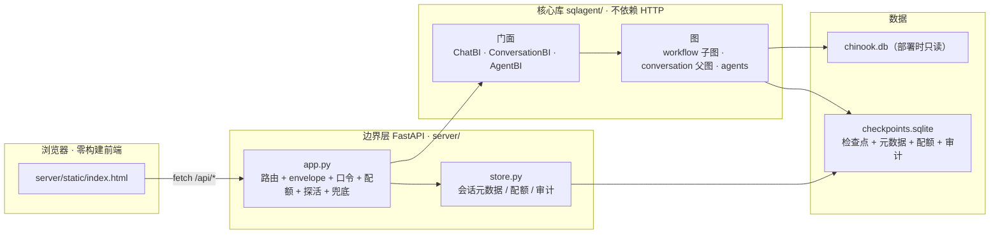
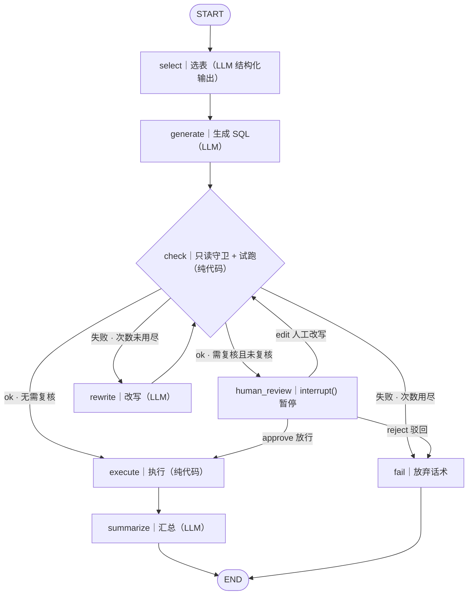
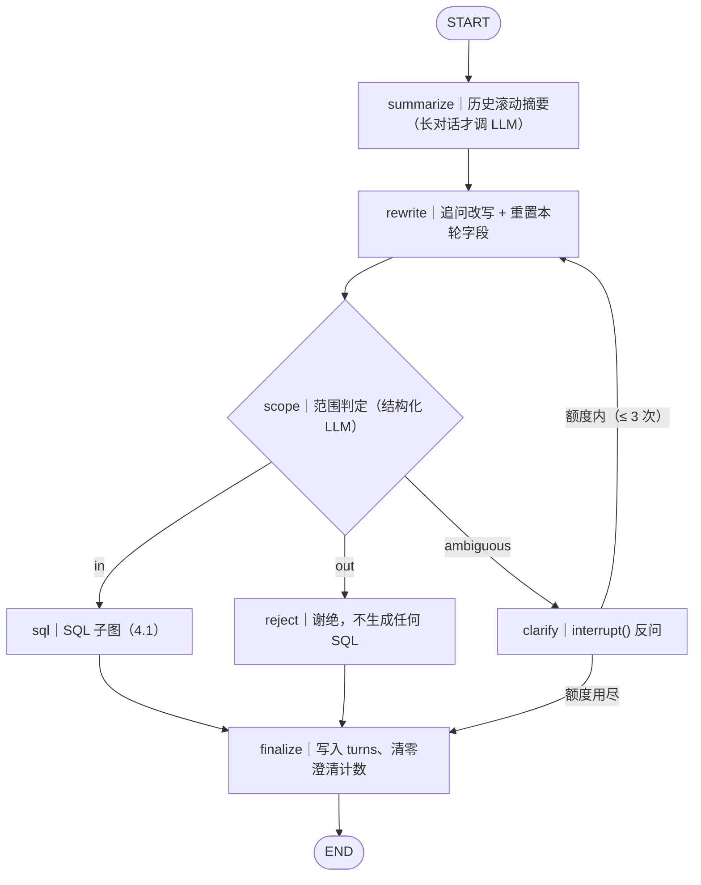
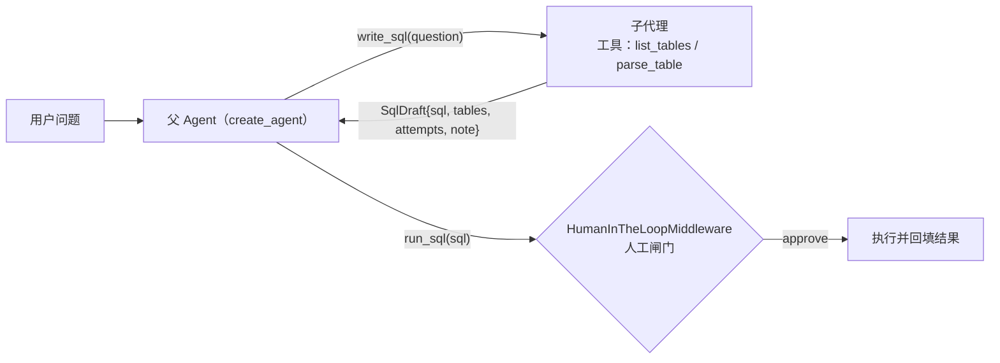

# SQL Agent · LangGraph 进阶版

> **自然语言 → 只读 SQL → 结论** 的完整闭环，并且**可暂停、可记忆、可回放**。
>
> 一个把「确定性编排」与「自主 Agent」两种做法**并排放在同一个仓库里跑**的 Text-to-SQL 项目：
> 内核（数据库 / 只读守卫 / 工具 / 裁判）只有一套，驱动方式有两条，并且都能接上人工闸门与持久化。

```
用户提问 ──► 范围闸门 ──► SQL 子图（选表 → 生成 → 守卫试跑 → 改写回环 → 执行 → 汇总）──► 结论
                │                                  ▲
                ├─ 越界 ──► 直接谢绝                 │
                └─ 含糊 ──► interrupt() 反问 ────────┘  （最多 3 次，可续接）
                                 ▲
                        人工复核闸门：interrupt() 暂停 → approve / edit / reject
```

| 你想先看什么 | 去哪里 |
|---|---|
| 跑起来 | [§2 快速开始](#2-快速开始) |
| **LangGraph 是怎么用的**（本文重点） | [§4](#4-langgraph-是怎么用的) |
| 每个文件干什么 | [§5 模块地图](#5-模块地图) |
| 两条路线的差异 | [§4.7 两条路线对照](#47-两条路线对照) |
| **中英双语怎么切换**（默认英文） | [§7 中英双语](#7-中英双语默认英文) |
| 上线 / 测试 | [§8](#8-上线裸-uvicorn-路线) · [§9](#9-测试与验证) |
| 设计取舍 / 上线 / 风险 | [DESIGN.md](DESIGN.md) · [PRODUCTION.md](PRODUCTION.md) · [FEATURES.md](FEATURES.md) |

---

## 1. 这是什么

### 1.1 一句话

上一代（Week11 的 `07-sql-agent-langchain`）证明了「**换框架 ≠ 换行为**」——
用 LangChain 重写裸 OpenAI SDK 的实现，提示词、重试次数、`temperature=0`、
「失败即放弃、不编造」的语义一律逐字保留。

这一代要证明「**换框架 ≠ 白换**」：在同样逐字保留行为的前提下，
多出三件**只有显式状态图才给得利落**的能力。

| 上一代自陈的缺口 | 这一代补上的能力 | 靠什么 |
|---|---|---|
| 「澄清反问为**单轮**，没有反问 → 等待 → 续接的状态机」 | **可暂停 / 可续接** | `interrupt()` + `Command(resume=...)` + `checkpointer` |
| 「生成 SQL **无人在环**」 | **人工复核闸门** | `interrupt()` 落在 SQL 子图内，载荷冒泡到图外 |
| 「失败定位靠**手写 trace**」 | **时间旅行** | `get_state` / `get_state_history` / `update_state` |

除此之外还有一层「上线」的工程化：FastAPI 边界层、口令、配额、审计、只读库、压测脚本（[§8](#8-上线裸-uvicorn-路线)）。

### 1.2 两条并列的路线

同一个问题，两种驱动方式，**共用同一套内核**（`db` / `guard` / `tools` / `judge`）：

| | `route=graph`（默认） | `route=agent` |
|---|---|---|
| 实现 | 手写 `StateGraph`，拓扑固定 | LangChain v1 `create_agent`，模型自选工具顺序 |
| SQL 由谁产出 | 子图里固定的 `select → generate → check → rewrite` 流水线 | 模型自己调 `write_sql`（子代理起草）+ `run_sql` 执行 |
| 人工闸门 | 子图内 `interrupt()`，续接值 `{"action": ...}` | `HumanInTheLoopMiddleware`，续接值 `{"decisions": [...]}` |
| 模型兜底 | `llm.build_chat_model` 的 `.with_fallbacks()` | `ModelFallbackMiddleware` |
| 门面类 | `ConversationBI` | `AgentBI` |

> **为什么不做成二选一**：图路线的长处是「每一步都可断言」（谁调了几次模型、失败往哪走都在拓扑里）；
> agent 路线的长处是「模型能自己决定要不要多看一张表」。两者对同一个问题给出可对比的轨迹，
> 才是这个仓库真正的价值（见 [§4.7](#47-两条路线对照)）。
> 顺带一提：`create_agent` 内部**就是**用 LangGraph 实现的——所以这不是「用不用 LangGraph」的选择，
> 而是「自己画图」还是「让框架画图」的选择。

### 1.3 亮点速览

- **零构建前端**：`server/static/index.html` 单文件，无 npm、无打包、无框架。
- **中英双语（默认英文）**：界面 / 交互 / 结果展示 / 分析整体切换，`[新建会话]` 右侧那个**蓝色按钮**一键翻转；详见 [§7](#7-中英双语默认英文)。
- **单一入口自动分流**：`in / out / ambiguous / sql_review / clarify` 五种分支全部由代码路由，不靠人工挑代码块（硬需求）。
- **150 项离线单测，零网络**：所有 LLM 调用都被假模型替换，`pytest` 随时随地可跑。
- **可复跑的证据**：并发压测脚本（假模型）+ 成本快照脚本（真模型），见 [§8.5](#85-上线自查)。
- **诚实标注边界**：哪些 LangGraph 特性**刻意没做**、哪些风险**尚未验证**，都写在文档里。

---

## 2. 快速开始

### 2.1 环境

- Python **3.12**
- 依赖见 [requirements.txt](requirements.txt)（在 `langchain 1.3.x / langgraph 1.2.x` 上验证通过）

```bash
pip install -r requirements.txt
# 可选：跨进程持久化需要它（不装则默认走 InMemorySaver，全部单测依然通过）
pip install langgraph-checkpoint-sqlite
```

### 2.2 配置 `.env`

`sqlagent/config.py` 会**从当前目录逐级向上**查找 `.env`，所以放在仓库根目录即可：

```bash
cp .env.example .env
# 然后填入 DEEPSEEK_API_KEY（或 QWEN_API_KEY + LLM_PROVIDER=qwen）
```

`.env` 已在 [.gitignore](.gitignore) 里，**绝不入库**。字段含义见 [.env.example](.env.example)。

> 只跑单测/离线演示**不需要**任何 Key：测试全部用假模型。

### 2.3 跑测试

```bash
pytest          # 150 passed（零网络）
```

### 2.4 网页版

```bash
python -m uvicorn server.app:app --reload --port 8000
# 浏览器打开 http://127.0.0.1:8000/
```

页面上可选**路线**（graph / agent）与**是否人工复核**；勾上复核后，生成 SQL 会**暂停**并弹出复核卡片
（放行 / 改写 / 驳回）。

**界面默认英文**：标题、按钮、示例、复核卡片、错误提示、以及模型的回答与分析都是英文。
`[新建会话]` **右侧那个蓝色按钮**是双语开关——它的文案与当前界面语言**相反**（英文态显示「中文」，
中文态显示「ENG」），点一下就整页切换。详见 [§7 中英双语](#7-中英双语默认英文)。

上线形态见 [§8](#8-上线裸-uvicorn-路线)。

### 2.5 命令行

```bash
# ① 基线：与上一代逐字一致（无 checkpointer、无人工闸门）
python -m sqlagent.cli "数据库里一共有多少首歌曲？"

# ② 换自主 Agent 路线（三角色 Agent + 同一套闸门）
python -m sqlagent.cli "有多少首歌？" --route agent --trace

# ③ 会话图：持久化 + 多轮记忆（带 --thread-id 即启用）
python -m sqlagent.cli --thread-id my-chat --repl

# ④ 人工复核（生成 SQL 后暂停，等 approve / edit / reject）
python -m sqlagent.cli "有多少首歌？" --review

# ⑤ 时间旅行：打印检查点轨迹 / 从任意一跳回放
python -m sqlagent.cli "有多少首歌？" --thread-id my-chat --trajectory
python -m sqlagent.cli --thread-id my-chat --replay <checkpoint_id>

# ⑥ 落盘持久化（换进程后仍可续跑）
python -m sqlagent.cli --thread-id my-chat --checkpointer sqlite --checkpoint-path ck.sqlite

# ⑦ 英文话术与英文结论（默认 zh；网页版反过来默认 en）
python -m sqlagent.cli "How many tracks are in the database?" --lang en
```

完整参数：

| 参数 | 取值 | 作用 |
|---|---|---|
| `question` | 位置参数 | 一次性提问；省略则进交互模式 |
| `--route` | `workflow`（默认）/ `agent` | 选后端 |
| `--lang` | `zh`（默认）/ `en` | 面向用户话术与结论的语言（见 [§7](#7-中英双语默认英文)） |
| `--repl` | flag | 多轮交互 |
| `--trace` | flag | 打印闸门与阶段轨迹 |
| `--db` | 文件名，默认 `chinook.db` | 数据库定位 |
| `--thread-id` | 字符串 | **任一带上 `--thread-id / --review / --trajectory / --replay` 即切到会话图** |
| `--checkpointer` | `memory`（默认）/ `sqlite` | 持久化后端 |
| `--checkpoint-path` | 路径 | sqlite 检查点文件 |
| `--review` | flag | 开启人工复核 |
| `--trajectory` | flag | 跑完打印检查点轨迹 |
| `--replay` | `CHECKPOINT_ID` | 从某跳回放（需配 `--thread-id`） |

> 会话图路径**只支持 `workflow` 路线**（带 `--route agent` 会提示并退出码 2）——
> agent 路线的持久化/闸门由 `server/` 与 `AgentBI` 负责。

### 2.6 演示 notebook

```bash
jupyter nbconvert --to notebook --execute --inplace sql-agent-advanced.ipynb
```

---

## 3. 架构总览

三层，边界清晰：**HTTP 归 `server/`，业务归 `sqlagent/`，SQL 归子图**。



**关键点**：`sqlagent/` 一行都不 import FastAPI ——
「能不能上线」是 `server/` 的事，「答得对不对」是核心库的事。
图形跑在同一进程内（同进程函数调用），没有网络跳。

---

## 4. LangGraph 是怎么用的

本节是这个仓库的核心。四张图（SQL 子图 / 会话父图 / 持久化 / agent 路线）+ 一张「机制 → 落点」速查。

### 4.1 SQL 子图：把 7 阶段流水线**画成一张图**

源码：[`sqlagent/workflow/graph.py`](sqlagent/workflow/graph.py)

原来的 `run_workflow()` 是一个手写 `for` 循环 + `if` 分支。改写成 `StateGraph` 后，**节点 = 阶段，边 = 流转，条件边 = 「校验失败该往哪走」**：

| 原实现 | 节点 | 类型 |
|---|---|---|
| `select_tables()` | `select` | 一次 LLM（结构化输出） |
| `generate_sql()` | `generate` | 一次 LLM |
| `is_readonly()` + `check_sql()` | `check` | **纯代码**（守卫 + 试跑） |
| `rewrite_sql()` | `rewrite` | 一次 LLM |
| `execute_sql()` | `execute` | **纯代码** |
| `summarize()` | `summarize` | 一次 LLM |
| `if ok or attempt == MAX_REWRITE: break` | `route_after_check()` | 条件边（纯代码） |



**要点**

1. **状态就是一个 `TypedDict`**（`WorkflowState`），字段与原来的 `trace` 字典一一对应 —— 图状态即数据契约。

    ```python
    class WorkflowState(TypedDict, total=False):
        question: str
        tables: list
        sql: str
        attempts: int
        ok: bool
        error: str | None
        columns: list | None
        rows: list | None
        answer: str | None
        review_action: str | None   # approve / edit / reject
        reviewed: bool              # 这条 SQL 是否已复核过
    ```

2. **唯一的回环**是 `rewrite → check`（自纠闭环）。改写后必然回到守卫与试跑，绝不放行未经校验的 SQL。

3. **`human_review` 节点是「按需入图」的**：`human_review=False` 时该节点**根本不加入图**，
   于是默认路径的拓扑与 LLM 调用次数与上一代完全一致（[§6 不变量](#6-契约与行为不变量)）。

4. **三个构图入口**，同一份定义三种用法：

    | 函数 | 产物 | 用途 |
    |---|---|---|
    | `_build_workflow(...)` | 未编译的 `StateGraph` | 供上面两种编译，也是「作为子图嵌入」的前提 |
    | `build_graph(...)` | 编译、**无 checkpointer** | 独立跑；**当子图嵌入父图**（LangGraph 硬性要求子图不得自带 checkpointer） |
    | `build_checkpointed_graph(...)` | 编译、带 checkpointer | 单图形态下支持断点续跑 / 人工介入 / 时间旅行 |

### 4.2 会话父图：把「一整轮对话」也纳入图

源码：[`sqlagent/conversation/graph.py`](sqlagent/conversation/graph.py) · 门面 [`bi.py`](sqlagent/conversation/bi.py)

上一代里，「三道闸门 + 多轮对话」是 `ChatBI` 里的纯 Python `if/elif`，
只有进到 `in` 分支才交给 LangGraph。这一代把这一层也变成图：



**这是全文最值得看的四处设计**：

1. **子图组合**：`g.add_node("sql", sql_subgraph)` —— 父图把状态**透传**给子图，子图写回的结果再并回父图。
   两个图的 `TypedDict` 刻意用**同名键**（`question / tables / sql / ...`），所以**不需要手工搬运**任何字段。
   而且 `sql_subgraph` 就是 `build_graph()` 的产物：**它自己仍能单独 `invoke()`**，既有测试原样通过。

2. **Reducer**：`turns` 用 `Annotated[list, operator.add]` 声明为**追加式**。
   节点只返回自己新增的那一条 `[(问题, 回答)]`，LangGraph 负责合并 —— 不需要读改写整个历史。

   ```python
   turns: Annotated[list, operator.add]
   ```

3. **澄清续接回环**（第二个也是唯一的第二个回环）：
   `ambiguous → clarify` 处调用 `interrupt()`，图**在此暂停**；用户下一条消息经 `Command(resume=...)`
   送回，作为新的 `raw_question` 重新走 `rewrite → scope`。这才真正实现了
   「反问 → 等待 → 续接」（上一代只能反问一轮）。

   额度用尽（`MAX_CLARIFY=3`）时**不再暂停**，直接给一段可读话术收尾 ——
   否则「用户怎么答都答不到点子上」会变成另一种挂死。

4. **滚动摘要代替硬截断**：`summarize` 节点只在「未摘要轮数 > `SUMMARY_TRIGGER`(8)」时才真调一次 LLM，
   把「除最近 `REWRITE_WINDOW`(5) 轮之外」的较早对话压成一段背景。
   短对话**零额外调用**，长对话也不会无限增长 —— 这正好满足「默认路径调用次数不变」的不变量。

**计数清零为什么放在 `finalize`**：`clarify → rewrite` 是**同一轮内**的回环，
若在 `rewrite` 里重置计数，上限永远够不到；而每轮都必过 `finalize`，所以「下一轮重新计数」由它负责。

### 4.3 持久化：`checkpointer` + `thread_id`

源码：[`sqlagent/session.py`](sqlagent/session.py)

```python
def make_checkpointer(kind="memory", path="checkpoints.sqlite"):
    # memory → InMemorySaver：零依赖，同进程可恢复（默认）
    # sqlite → SqliteSaver：落盘，跨进程重启也能恢复
```

接上 checkpointer 后，**中间状态按 `thread_id` 落进检查点库**，于是：
多轮记忆、被 `interrupt()` 暂停的图、以及任意一跳的历史快照都成了可读数据。
`ConversationBI.turns` 就是**读检查点**得来的（`graph.get_state(config)`），不依赖进程内存。

> 部署时它换成了 `SqliteSaver`，并与会话元数据 / 配额 / 审计**共用一个 SQLite 文件**（同库不同表），
> 见 [§8](#8-上线裸-uvicorn-路线)。

### 4.4 人工介入：`interrupt()` / `Command(resume=...)`

源码：[`sqlagent/hitl.py`](sqlagent/hitl.py)（驱动器）+ [`workflow/graph.py`](sqlagent/workflow/graph.py)（闸门本身）

`interrupt()` 只负责**暂停**：把载荷抛出图外，等外部用 `Command(resume=<值>)` 送回来才继续。
`hitl.py` 就是那个「外部」：

```python
# 闸门侧（子图内）：抛出一个载荷并停下
decision = interrupt({"type": "sql_review", "question": ..., "sql": ..., "attempt": ...})

# 驱动侧（图外）：拿到载荷 → 问人 → 带答复续跑
while (payload := pending_interrupt(result)) is not None:
    result = graph.invoke(Command(resume=reviewer(payload)), config)
```

三种决定：`approve`（放行）/ `edit`（人工改写 → **回到 `check` 重新校验**）/ `reject`（驳回 → 走 `fail`）。

两条不显眼但重要的设计：

- **`reviewed` 标志**：LLM 改写产生的 SQL 会把 `reviewed` 置回 `False`，于是它**必须再复核一次**；
  人工改写的 SQL 也一样要重新过守卫与试跑。避免「人工刚改完，又被要求批一次」。
- **`interrupt()` 只允许留在父图**：批 5 的 SQL 生成子代理内部**明令不许 `interrupt()`**（D23），
  否则「一个会话一个闸门」的交互契约会被子图里的暂停打乱。

### 4.5 时间旅行：轨迹与回放

源码：[`sqlagent/time_travel.py`](sqlagent/time_travel.py)

```python
list_hops(graph, config)          # 列出每一跳（= 一个检查点快照）的可读摘要
format_hops(hops)                 # 渲染成纯文本
checkpoint_before(graph, config, "generate")   # 找到「下一跳将进入 generate」的那个检查点
replay_from(graph, config, checkpoint_id, updates={...})   # 从任意一跳重跑（可先改状态做 A/B）
```

实现要点：回放必须用该跳 `StateSnapshot` 自带的 `.config`（内含 `checkpoint_ns` / `checkpoint_id`），
**只靠 `thread_id + checkpoint_id` 拼出来的 config 会被检查点库拒绝**；
若要改状态，先 `update_state()` 在那一跳**分叉**出新检查点，再用返回的新 config 续跑。

这就是「失败定位」的进阶形态：原先靠手写 trace 猜卡在哪一步，现在可以直接**回到那一步重跑**。

### 4.6 自主 Agent 路线：`create_agent` + middleware

源码：[`sqlagent/agents/sql_agent.py`](sqlagent/agents/sql_agent.py) · 门面 [`agents/session.py`](sqlagent/agents/session.py)

LangChain v1 的 `create_agent` 返回的**就是一张 LangGraph 图**（`model ⇄ tools` 循环），
本仓库在此基础上加了两层 middleware：

| middleware | 作用 | 为什么 agent 路线非它不可 |
|---|---|---|
| `ModelFallbackMiddleware` | 主模型失败时切备用模型 | `create_agent` 要求真 `BaseChatModel`，而 `.with_fallbacks()` 的产物是 `RunnableWithFallbacks`，**喂不进去** |
| `HumanInTheLoopMiddleware` | `run_sql` 执行前 `interrupt()` 等人工放行 / 改写 / 驳回 | 补上「Agent 直接执行、无人工闸门」的缺口 |

**批 5：SQL 生成子代理（`write_sql`）**

为解「schema 原文撑大父上下文」这一问题，把 SQL 的**起草 + 自纠**挪进一个**只拿问题文本**的子代理：



- **上下文边界（D22）**：子代理**只收到问题文本**，自己用 `list_tables` / `parse_table` 探索 schema。
  父上下文里只多一条 JSON 摘要（`SqlDraft`），看不到 schema 原文、试跑报错、每一版草稿。
- **输出契约（D23）**：子代理的唯一产物是 `SqlDraft{ sql, tables, attempts, note }`（Pydantic）。
  `trace.sql` / `trace.attempts` 由它回填，**键集合与形状逐字不变**（见 [`agents/session.py`](sqlagent/agents/session.py)）。
- **闸门位置**：子代理**不给 `run_sql`、不挂 middleware、内部不许 `interrupt()`** —— 执行仍由父图走人工闸门。
- **已知代价**：子代理每轮都是**全新窗口**，必须重新探索 schema。实测主上下文约缩小 **7 倍**，
  但输入 token **+42%**、调用次数 19 vs 8 —— **context 是正收益，token 是负收益**。
  用户裁决：**保留**（买的就是隔离）。详见 [PRODUCTION.md](PRODUCTION.md) §7 风险 6 与 [§11](#11-已知限制与下一步)。

### 4.7 两条路线对照

| | `route=graph` | `route=agent` |
|---|---|---|
| 图从哪来 | 手写 `StateGraph`（父图 + SQL 子图） | `create_agent` 自动生成 `model ⇄ tools` 循环 |
| 拓扑 | 固定，可 `draw_mermaid()` 画出 | 由模型在运行时决定 |
| SQL 生成 | `select → generate`（结构化 LLM + 文本 LLM） | `write_sql` 子代理起草 + 自纠 |
| 范围闸门 | 有（`scope` 节点，in/out/ambiguous） | 无（靠系统提示词约束） |
| 多轮记忆 | 检查点里的 `turns`（`operator.add` 追加） | 从 agent 消息轨迹反推 `turns` |
| 人工续接值 | `{"action": "approve"/"edit"/"reject"}` | `{"decisions": [{"type": ...}]}` |
| `trace` 差异 | 有 `attempts`、无 `route` | 有 `route`、`attempts` 由子代理摘要回填 |
| 适合 | 需要每一步可断言、可控成本 | 需要模型自己决定探索范围 |

两者都提供 `ask()` / `resume()` / `turns` / `graph` / `config` ——
所以 `server/app.py` 只用一个 `_sessions` 字典就能同时装两种会话，前端也共用一套交互。

### 4.8 机制 → 落点速查

| LangGraph / LangChain 机制 | 用在哪 | 文件 |
|---|---|---|
| `StateGraph` + `TypedDict` 状态 | SQL 子图、会话父图 | [`workflow/graph.py`](sqlagent/workflow/graph.py) · [`conversation/graph.py`](sqlagent/conversation/graph.py) |
| 条件边（`add_conditional_edges`） | 校验分支、范围分支、复核分支、澄清出口 | 同上 |
| 回环 | `rewrite → check`（自纠）、`clarify → rewrite`（澄清续接） | 同上 |
| 子图（`add_node("sql", subgraph)`） | 父图挂载 SQL 流水线 | [`conversation/graph.py`](sqlagent/conversation/graph.py) |
| Reducer（`Annotated[list, operator.add]`） | 会话历史 `turns` | 同上 |
| Checkpointer（`InMemorySaver` / `SqliteSaver`） | 持久化、可暂停 | [`session.py`](sqlagent/session.py) |
| `thread_id` / `config` | 会话线程寻址 | [`session.py`](sqlagent/session.py) |
| `interrupt()` / `Command(resume=)` | 人工复核、澄清反问 | [`hitl.py`](sqlagent/hitl.py) · [`workflow/graph.py`](sqlagent/workflow/graph.py) |
| `get_state` / `get_state_history` / `update_state` | 会话历史、轨迹、回放 | [`time_travel.py`](sqlagent/time_travel.py) |
| `create_agent` | agent 路线 | [`agents/sql_agent.py`](sqlagent/agents/sql_agent.py) |
| `HumanInTheLoopMiddleware` / `ModelFallbackMiddleware` | agent 路线的闸门与兜底 | 同上 |
| `@tool` + 工具工厂（闭包绑定） | 给模型暴露 `list_tables` / `parse_table` / `run_sql` | [`tools.py`](sqlagent/tools.py) |
| `with_structured_output(Pydantic)` | 选表、范围判定、裁判 | [`llm.py`](sqlagent/llm.py) · [`schemas.py`](sqlagent/schemas.py) |
| `with_retry` / `with_fallbacks` | 文本路径的重试与兜底 | [`llm.py`](sqlagent/llm.py) |

---

## 5. 模块地图

```
sqlagent/                       核心库（不依赖 HTTP）
├── config.py                   .env 逐级查找 · 模型设置 · 库定位 · 脱敏
├── llm.py                      模型接入层：ChatOpenAI / with_retry / with_fallbacks / 结构化输出
├── prompts.py                  全部提示词（中文逐字沿用上一代；另配 4 条英文变体 + `*_prompt(lang)` 选择器）
├── i18n.py                     双语文案层：固定话术的中英对照 + `text(name, lang)` / `normalise(lang)`
├── schemas.py                  Pydantic 输出契约：TableSelection / ScopeJudgement / 四个 Judge
├── db.py                       DBParser：表反射 · 字段画像 · 外键 · check_sql · execute_sql
├── guard.py                    is_readonly()：只读 SQL 的结构性守卫（纯代码，不进提示词）
├── tools.py                    共享工具层：schema 拼装 + list_tables / parse_table / run_sql（@tool）
├── gates.py                    [A] 追问改写 · [B] 范围判定 · 历史摘要（纯逻辑，供图复用）
├── chatbi.py                   ChatBI：基线门面（answered 由 run_workflow 产出）；re-export gates 旧路径
│
├── workflow/graph.py           ★ SQL 子图：7 阶段 + 校验回环 + 人工复核闸门
├── conversation/               ★ 会话父图 + ConversationBI 门面
│   ├── graph.py                父图：summarize / rewrite / scope / sql(子图) / clarify / reject / finalize
│   └── bi.py                   ConversationBI：ask / resume / turns / graph / config
├── agents/                     ★ agent 路线
│   ├── sql_agent.py            SQLAgent（三角色）· build_autonomous_agent · write_sql 子代理 · middleware
│   └── session.py              AgentBI：与 ConversationBI 同形的多轮门面
│
├── session.py                  checkpointer 工厂 + thread_id / config 助手
├── hitl.py                     pending_interrupt / review_loop（人工介入驱动器）
├── time_travel.py              list_hops / format_hops / checkpoint_before / replay_from
├── evalset.py                  评测集：GOLDEN_SET(12) + STRUCTURE_PROBES(5) + QuestionSimulator
└── judge/                      逐层裁判
    ├── deterministic.py        L0/L1/L3/L4/L5 确定性裁判（零 LLM 调用）
    └── llm.py                  L2 SQL 等价 · L1 增补 · L4 复核 · L5 答案忠实度

server/                         边界层
├── app.py                      路由 · envelope(D15) · 口令(D10) · 配额(D11) · 兜底(D6) · /health(D16)
├── store.py                    会话元数据（含 `lang`）/ 配额 / 审计（与检查点同库不同表）
├── messages.py                 失败话术（D18，只放字符串不放逻辑；中英各一套）
└── static/index.html           单文件前端：口令页 · 路线选择 · 五种中断卡片 · 历史 · **蓝色中英切换按钮**

scripts/
├── loadtest.py                 并发压测（离线假模型，真起 uvicorn）
└── cost_snapshot.py            成本快照（真模型，读审计表）

tests/                          150 项离线单测
```

**几条贯穿全局的设计原则**（详见 [FEATURES.md](FEATURES.md) 与 [DESIGN.md](DESIGN.md)）：

- **Structure vs Prompt**：护栏做进**代码结构**（`guard.py` 刻意不套框架、不写进提示词），
  即使模型被越狱、提示词被改写，写操作也到不了数据库。
- **契约优先**：结构化输出一律给 Pydantic 模型；API 响应一律给 envelope；失败一律给话术。
- **懒导出**（PEP 562）：`import sqlagent` 不牵出 `matplotlib` / `IPython` 等重依赖。
- **不重建轮子**：两条路线共用 `db` / `guard` / `tools` / `judge` 内核。

---

## 6. 契约与行为不变量

这四条来自 [DESIGN.md](DESIGN.md) §4，是**硬约束** —— 任何改动与它们冲突都以它们为准：

1. **`run_workflow(question, parser, verbose=True)` 的签名与返回字段逐字不变**
   （仍走无 checkpointer、`human_review=False` 的图；LLM 调用次数不变）。
2. **默认路径不产生额外 LLM 调用**：`human_review=False` 时复核节点**根本不加入图**。
3. **既有单测原样通过**：拓扑断言用子集判断（`{"select", ...} <= set(nodes)`），所以新增节点安全。
4. **旧导入路径继续可用**：`from sqlagent.chatbi import scope_check` 等经 re-export 保持兼容。

> **双语怎么做到不破这四条**：`lang` 是一个**只影响取哪套文案**的附加参数，
> 每个核心库 API 的默认值都是 `zh`（`i18n.DEFAULT_LANG`）——
> 所以 `run_workflow` 的签名、节点拓扑、LLM 调用次数、既有测试预期**一个字都没动**；
> 默认路径下 `i18n.text(name)` 取到的就是原来那些模块级常量（`FAIL_ANSWER` /
> `OUT_OF_SCOPE_TEMPLATE` / `CLARIFY_LIMIT_ANSWER` 的名字与中文内容逐字保留）。
> 只有 `en` 才切到新增的英文变体。详见 [§7](#7-中英双语默认英文)。

**API 层的两个数据契约**

```jsonc
// D15 envelope：每个 /api/* 响应的外层
{
  "session_id": "...", "trace_id": "...", "route": "graph", "status": "done",
  "degraded": false, "events": [{"type": "final"}],
  "trace": { /* 11 个键，逐字不变 */ }
}

// trace 的 11 个键（graph 路线）
// raw_question · standalone_question · scope · tables · sql · attempts
// ok · columns · rows · answer · status
// （status="interrupted" 时额外带 interrupt 载荷）
```

agent 路线的 `trace` 把 `attempts` 换成 `route`（键数仍为 11）。

---

## 7. 中英双语（默认英文）

**产品网页默认英文**：界面、交互提示、结果表格、复核卡片、错误话术，以及**模型的结论与分析**，
全部默认英文；`[新建会话]` **右侧那个蓝色按钮**一键切到中文，再点一下切回英文。

### 7.1 交互：按钮文案与当前语言**相反**

| 当前界面语言 | 按钮显示 | 点一下之后 |
|---|---|---|
| 英文（默认） | **中文** | 整页变中文，按钮自己变成 **ENG** |
| 中文 | **ENG** | 整页变英文，按钮自己变回 **中文** |

- 按钮就在 `[新建会话]` 右侧（`server/static/index.html` 的 `.ctl` 里 `#new` 之后），**蓝色底**
  （`background:var(--acc)`），与旁边白底的「新建会话」一眼可分。
- 选中的语言记在 `localStorage`（键 `sqlagent.lang`），**下次打开沿用**；**首次访问默认英文**。
- 切换是**整页就地刷新**（不重载页面）：标题、按钮、placeholder、示例、后续所有卡片都跟着换。
- 命令行侧对应 `--lang zh|en`，**默认 `zh`**（见 [§2.5](#25-命令行)）——
  核心库是「默认中文、可选英文」，网页是「默认英文、可切中文」，两者都只是把 `lang` 显式传进去。

### 7.2 语言是**会话属性**，不是界面属性

这点决定了「模型的回答与分析也能跟着换语言」：

```
前端 LANG ──POST /api/session {lang}──► store.sessions.lang（落库）
                                            │
                       进程重启 / 缓存未命中时按它重建 bot
                                            ▼
                        ConversationBI / AgentBI(lang=…) ──► 图节点闭包 / 提示词
                                            │
                                     trace.answer（结论语言）
```

- 建会话时前端把 `lang` 一起提交，**落在 `sessions.lang` 列**（`server/store.py`）。
- `server/app.py` 的 `_entry()` 重建 bot 时从元数据取回 `lang`，所以**重启后旧 `session_id`
  仍然是原来的语言**。
- 请求头 `X-Lang` 只在一处兜底：**还不知道是哪个会话**的失败（口令 / 500 / 404）。
  会话级的话术（配额、降级）一律以**落库的会话语言**为准。

### 7.3 双语落在哪些文件

| 层 | 文件 | 做了什么 |
|---|---|---|
| 文案（单一事实源） | [`sqlagent/i18n.py`](sqlagent/i18n.py) | 13 条固定话术的中英对照 + `text(name, lang)` / `normalise(lang)` |
| 提示词 | [`sqlagent/prompts.py`](sqlagent/prompts.py) | 4 条「产出自然语言」的提示词配英文变体 + `*_prompt(lang)` 选择器 |
| 闸门 | [`sqlagent/gates.py`](sqlagent/gates.py) | `scope_check` / `rewrite_followup` / `summarize_history` 收 `lang` |
| 会话图 | [`conversation/graph.py`](sqlagent/conversation/graph.py) · [`bi.py`](sqlagent/conversation/bi.py) | 节点闭包按 `lang` 取话术；越界谢绝 / 澄清反问 / 澄清超限 / 人工复核兜底理由全部双语 |
| agent 路线 | [`agents/sql_agent.py`](sqlagent/agents/sql_agent.py) · [`session.py`](sqlagent/agents/session.py) | 系统提示词（含「用英文给结论」那句）、失败话术、`scope_check` 调用 |
| 基线门面 | [`chatbi.py`](sqlagent/chatbi.py) · [`cli.py`](sqlagent/cli.py) | `ChatBI(lang=…)`；`--lang zh\|en` |
| 边界层 | [`server/messages.py`](server/messages.py) | 失败话术中英各一套（模块级常量仍是中文，英文走 `text(name, "en")`） |
| 状态 | [`server/store.py`](server/store.py) | `sessions.lang` 列 + 老库 `ALTER TABLE` 补列（幂等） |
| 路由 | [`server/app.py`](server/app.py) | `SessionIn.lang` / `_request_lang()` / `_build_bot(lang=…)` / 重建 bot 时回填语言 |
| 前端 | [`server/static/index.html`](server/static/index.html) | `I18N{en,zh}` 字典 + `applyI18n()` + `#lang` 蓝色按钮 + `localStorage` |

**只翻译「产出自然语言」的四条提示词**：选表 / 生成 SQL / 改写 SQL 这三条**故意不配**英文版 ——
它们的产物是表名与 SQL，与自然语言无关；少一份变体就少一处会漂移的「第二事实源」。

### 7.4 为什么这样加语言，不会破坏不变量

见 [§6](#6-契约与行为不变量) 的那段注解。一句话：**`lang` 的默认值是 `zh`，`zh` 分支就是改动前的那份代码**
—— 拓扑、LLM 调用次数、提示词正文、模块级常量名与值，全部逐字未动。

### 7.5 切换语言为什么要**新建会话**

图 / Agent 的提示词是在**建会话那一刻**定下来的（闭包 + 系统提示词），只换界面文案无法让
「已经建好的会话」改口。所以点按钮时前端做两件事：① 立刻换掉整页文案；② **新建一个会话**
（并用当前语言提交），并提示「Language switched to English · a new session was started」。

> 代价是历史被清空 —— 这是**有意**的：混着两种语言的 `turns` 会让追问改写与结论语言都变糊。

### 7.6 怎么验证

```bash
pytest tests/test_i18n.py -q      # 39 项：文案一一对应 / 提示词选择器 / 话术贯通 / 落库迁移 / API
```

- 文案层：中英一一对应、无空串、不重样；`normalise` 吃掉大小写与 `en-US` 这类区域后缀。
- 默认不变：`i18n.DEFAULT_LANG == "zh"`、`summarize_prompt() is SUMMARIZE_PROMPT`（**同一对象**，不是副本）。
- 贯通：`lang="en"` 的越界谢绝 / 澄清超限话术为英文；`lang="zh"` 的谢绝话术**逐字等于原模板**。
- 落库：`sessions.lang` 往返读写；**老库没这列时开库自动补列**且幂等。
- API：`lang` 随会话落库、404 话术随 `X-Lang`、英文会话的 `trace.answer` 是英文。
- 手工：起服务后看默认英文界面 → 点 `[新建会话]` 右侧蓝色按钮 → 变中文且按钮显示 `ENG` → 刷新页面语言被记住。

**真模型实测**（`deepseek`，同一服务）：

```
英文会话：How many tracks are in the database?  → SELECT COUNT(*) FROM tracks; → "There are 3,503 tracks in the database."
中文会话：数据库里一共有多少首歌曲？              → SELECT COUNT(*) FROM tracks; → "数据库里一共有 3503 首歌曲（tracks 表共 3503 条记录）。"
```

---

## 8. 上线（裸 uvicorn 路线）

`server/` 是**边界层**：FastAPI 只负责 HTTP，图跑在同一进程内。
所以「上线」= 一个 uvicorn 进程 + 一个反代 + 一份 `.env`，**不需要容器**。
完整决策与风险见 [PRODUCTION.md](PRODUCTION.md)。

### 8.1 一条命令起服务

```bash
cd /path/to/sql-agent-LangGraph-advanced
python -m uvicorn server.app:app --host 0.0.0.0 --port 8000 --workers 1
```

- **`--workers 1` 是硬要求**：状态（检查点 + 会话元数据 + 配额 + 审计）都在一个 SQLite 文件里，
  多进程会各留一份「会话缓存 / 配额计数」，还把写锁竞争放大。要横向扩得先换 Postgres。
- 生产**不要**带 `--reload`。

### 8.2 `.env`（上线必填三项）

```ini
# 1) 只读打开业务库：把「只读」从代码约定升级为数据库强制
DB_URL=sqlite:///file:/abs/path/chinook.db?mode=ro&uri=true
# 2) 访问口令：留空 = 不校验（仅本地）；上线必填
APP_PASSCODE=<一串只发给受邀者的字符>
# 3) 状态文件：检查点 + 会话元数据 + 配额 + 审计共用一个 SQLite 文件
STATE_DB_PATH=/var/lib/sqlagent/checkpoints.sqlite
```

配额（每日全局 200 轮 / 单会话 20 轮）与会话保留期（7 天）是 [`server/store.py`](server/store.py) 里的常量。

### 8.3 常驻（systemd）

```ini
# /etc/systemd/system/sqlagent.service
[Unit]
Description=SQL Agent (LangGraph advanced)
After=network.target

[Service]
User=sqlagent
WorkingDirectory=/opt/sql-agent-LangGraph-advanced
EnvironmentFile=/opt/sql-agent-LangGraph-advanced/.env
ExecStart=/opt/sql-agent-LangGraph-advanced/.venv/bin/python -m uvicorn server.app:app \
          --host 127.0.0.1 --port 8000 --workers 1
Restart=always
RestartSec=3

[Install]
WantedBy=multi-user.target
```

### 8.4 HTTPS 反代（Caddy）

```caddyfile
your.domain.com {
    reverse_proxy 127.0.0.1:8000
}
```

口令 cookie 已是 `httpOnly` + `samesite=lax`；走公网 HTTPS 时建议再加 `secure=True`
（[`server/app.py`](server/app.py) 里的 `set_cookie` 一行）。

### 8.5 上线自查

```bash
curl -s localhost:8000/health
# {"ok":true,"version":"1.0.0","tables":11,"state_db_writable":true}
```

`ok=false` 只可能是状态库写不进去（挂卷只读 / 磁盘满 / 权限不对），监控应据此告警。

两份可复跑的脚本：

```bash
python scripts/loadtest.py        # 并发压测（离线假模型，真起 uvicorn）：验并发与状态
python scripts/cost_snapshot.py   # 5 轮典型对话的 token / 耗时 / 降级（真模型）：验成本
```

---

## 9. 测试与验证

**150 项，零网络**（所有 LLM 调用都被假模型替换）：

```bash
pytest
```

| 测试文件 | 覆盖 |
|---|---|
| [`test_db_parser.py`](tests/test_db_parser.py) | 表反射、双引擎一致性（SQLAlchemy == 原生 sqlite3）、报错检测 |
| [`test_guard.py`](tests/test_guard.py) | 只读守卫：放行 SELECT/WITH，拦下 DROP/DELETE/PRAGMA/多语句/ATTACH |
| [`test_tools.py`](tests/test_tools.py) | 共享工具层：`table_catalog` / `schema_context` / `run_readonly_sql` / `MAX_ROWS` 截断 |
| [`test_llm.py`](tests/test_llm.py) | 模型接入层硬参数：`request_timeout`、`max_retries` |
| [`test_gates.py`](tests/test_gates.py) | 三道闸门：[A] 改写（无历史时不调模型）/ [B] 范围判定 / [C] 三分支 |
| [`test_workflow_graph.py`](tests/test_workflow_graph.py) | SQL 子图：7 阶段串接 + 校验/改写回环 |
| [`test_conversation_graph.py`](tests/test_conversation_graph.py) | 会话父图：持久化 / 澄清续接 / 人工介入三分支 |
| [`test_time_travel.py`](tests/test_time_travel.py) | 时间旅行 + 人工介入驱动器 |
| [`test_agent_route.py`](tests/test_agent_route.py) | agent 路线：middleware 装配 + `AgentBI` 人工介入 |
| [`test_agent_subagent.py`](tests/test_agent_subagent.py) | 批 5 子代理：上下文边界 / 输出契约 / 闸门位置 |
| [`test_server_api.py`](tests/test_server_api.py) | 边界层：单一入口自动分流（D5）+ 信封（D15）+ 异常兜底（D6） |
| [`test_server_state.py`](tests/test_server_state.py) | 重启后仍可续问 / 口令 401 / 配额用尽 / 审计落表 |
| [`test_i18n.py`](tests/test_i18n.py) | 中英双语：文案一一对应 / 提示词选择器 / 话术贯通 / `sessions.lang` 落库与老库迁移 / `--lang` / API |
| [`test_judge.py`](tests/test_judge.py) | 逐层裁判的确定性部分（L0/L1/L3/L4/L5） |

**怎么做到零网络**：`tests/conftest.py` 提供真实 `chinook.db` 的 `DBParser` fixture，
外加两个「按序应答 / 按 schema 应答」的假模型工厂；agent 路线用脚本假模型 +
**真实的 `create_agent` 图**，所以 middleware / checkpointer 的行为都是真的。

补充说明：本仓库当前记为 **150 项全绿**（基线 75 项 + 上线硬化与子代理 36 项 + 中英双语 39 项）。

---

## 10. 目录结构

```
sql-agent-LangGraph-advanced/
├── README.md / DESIGN.md / FEATURES.md / PRODUCTION.md     ← 文档
├── sql-agent-advanced.ipynb                                ← 演示 notebook（已执行并保存输出）
├── requirements.txt / pytest.ini / .env.example / .gitignore
├── chinook.db                                              ← 示例数据库（11 张表）
├── sqlagent/                                               ← 核心库（见 §5）
├── server/                                                 ← 边界层 + 单文件前端
├── scripts/                                                ← 压测 / 成本快照
└── tests/                                                  ← 150 项离线单测
```

---

## 11. 已知限制与下一步

**已识别、已测量、且**（在权衡后）**有意保留**的问题：

- **子代理的 token 负收益**：`write_sql` 子代理每轮全新窗口、须重新探索 schema，
  换来主上下文约 **7 倍缩小**，但输入 token **+42%**、LLM 调用 **19 vs 8**。
  保留的理由：D22 买的就是「父上下文不被 schema 撑大」这件事本身。
  两个后续方向：① 子代理**会话级复用**探索窗口；② 父图先把**指代式追问**改写成自包含问题再交给子代理
  （子代理只拿问题原文，看不到上文，这是 D22 的直接代价）。详见 [PRODUCTION.md](PRODUCTION.md) §7 风险 6。
- **`graph` 路线不做子代理**（有意为之）：它的上下文本来就被 `scope → tables → schema_context`
  切成有界小块，没有痛点，抽子代理只会净增调用。

**尚未验证的风险**（[PRODUCTION.md](PRODUCTION.md) §7 有完整清单）：
长会话下 `list_hops` 的性能、`mode=ro` 反射在极端场景下的行为等。

**明确不做**（non-goals）：账号体系、SSE 流式、多 worker / Postgres / Redis、
容器化、前端框架、改动 [§6](#6-契约与行为不变量) 的四条不变量。

**刻意未覆盖的 LangGraph 特性**（诚实标注，见 [FEATURES.md](FEATURES.md)）：
Streaming、`Send` / map-reduce 并行、长期记忆 `BaseStore`、静态断点
`interrupt_before`/`interrupt_after`、LangSmith 可观测性、`langgraph.prebuilt`。

---

## 12. 相关文档

| 文件 | 讲什么 |
|---|---|
| [DESIGN.md](DESIGN.md) | **设计取舍**：会话图架构、三件套逐一设计、契约与限制 |
| [FEATURES.md](FEATURES.md) | **能力清单**：项目覆盖了哪些 LangGraph / LangChain 特性，以及**没覆盖**哪些 |
| [PRODUCTION.md](PRODUCTION.md) | **上线决策**：D1–D23 决策记录、五批实施、验收证据、风险与未验证项 |
| [`sql-agent-advanced.ipynb`](sql-agent-advanced.ipynb) | 把三件套**跑给你看**的演示 notebook |
