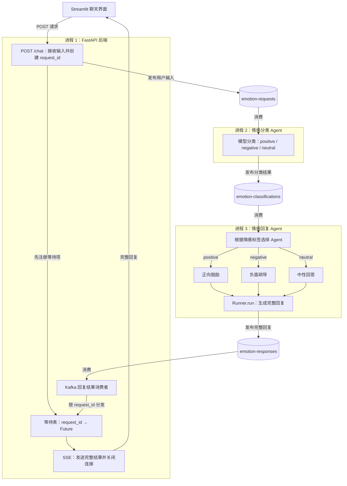
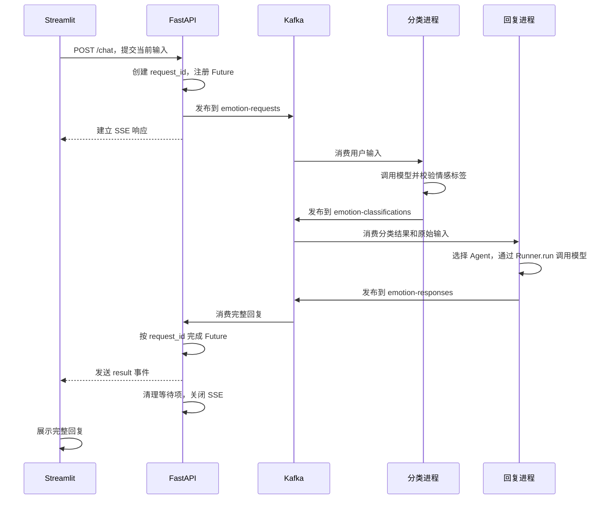

# 基于 OpenAI Agents SDK 与 Kafka 的情感分析聊天系统

使用 Streamlit 提供聊天界面，通过 FastAPI、Kafka 和两个独立 Agent 进程完成情感分类与回复生成，再通过 SSE 将完整回复返回前端。

用户输入分为正向、负面和中性三类，分别获得鼓励、疏导或简短回答。每条输入独立处理，页面聊天记录仅用于展示，不作为模型上下文。

分类和回复均关闭模型思考模式。回复使用中文，提示词要求全文约 50 字（尽量 40 至 60 字）、1 至 2 句话，只输出最终回复。

## 1. 技术组成

| 组件 | 用途 |
| --- | --- |
| Python 3.12 / Conda `badou_env3.12` | 项目运行环境 |
| Streamlit | 聊天输入、等待提示和回复展示 |
| FastAPI / Uvicorn | HTTP 接口、应用生命周期和 SSE 响应 |
| Kafka 4.3.2 / aiokafka | 进程间消息传递 |
| OpenAI Agents SDK / openai | Agent 定义、函数工具、异步运行和模型调用 |
| HTTPX | 前端发起 POST 请求并读取 SSE |
| Pydantic / pydantic-settings | 消息校验和环境配置 |

Python 依赖版本见 `requirements.txt`。模型服务需兼容 OpenAI Chat Completions 接口，并支持工具调用，以满足分类器的结构化输出要求。

## 2. 进程与运行流程

系统包含三个后端业务进程。Streamlit 前端和 Kafka 服务分别运行。

| 进程 | 启动模块 | 职责 |
| --- | --- | --- |
| FastAPI 后端 | `backend.main` | 接收输入、发布请求、消费回复结果、通过 SSE 返回前端 |
| 情感分类 Agent | `backend.classifier_main` | 消费用户输入，识别情感标签，发布分类结果 |
| 情感回复 Agent | `backend.responder_main` | 消费分类结果，选择对应 Agent，调用模型生成完整回复 |

FastAPI 的结果消费者在同一进程中作为异步任务运行。回复进程使用一个 `Responder`，内部创建三个共享模型客户端的 SDK `Agent`，根据情感标签选择其中一个，每条请求调用一次回复模型。分类和回复仍通过 Kafka 衔接，不使用 SDK handoff 改变进程间流程。

### 进程间流程图



分类或回复处理失败时，对应进程将错误结果发送到 `emotion-responses`，由 FastAPI 转为 SSE 错误事件。

### 单次请求时序



等待项先于 Kafka 请求消息创建，因此提前到达的结果也能正确保存。每次提问建立一次 SSE 连接，完整结果返回后关闭，不逐 token 输出。

## 3. 项目结构

```text
emotion_analysis_openaiagents/
├── README.md                       # 项目说明与运行指南
├── requirements.txt                # Python 依赖版本
├── .env                            # 按下文手动创建的本机配置，不提交到版本库
├── frontend/
│   ├── __init__.py
│   ├── app.py                      # Streamlit 聊天页面和 HTTP 请求
│   └── sse.py                      # SSE 事件解析
└── backend/
    ├── __init__.py
    ├── main.py                     # 应用创建、路由注册和生命周期管理
    ├── classifier_main.py          # 分类进程启动入口
    ├── responder_main.py           # 回复进程启动入口
    ├── app/
    │   ├── __init__.py
    │   └── routes.py               # HTTP 接口、结果分发和 SSE 响应
    ├── model/
    │   ├── __init__.py
    │   └── schemas.py              # 请求、分类、回复和错误数据模型
    ├── agents/
    │   ├── __init__.py
    │   ├── classifier/
    │   │   ├── __init__.py
    │   │   └── classifier.py       # 分类 Agent、函数工具与结构化输出
    │   └── responder/
    │       ├── __init__.py
    │       └── responder.py        # 按情感选择回复 Agent 并运行
    └── common/
        ├── __init__.py
        ├── settings.py             # 环境配置与日志格式
        ├── kafka_utils.py          # Kafka 连接、消息处理、发布和位点提交
        └── llm.py                  # AsyncOpenAI 客户端与 Chat Completions 模型创建
```

`routes.py` 中的 `ResultDispatcher` 管理请求等待表，并将 Kafka 回复交给对应请求。`kafka_utils.py` 中的 `run_worker` 提供两个 Agent 共用的消息处理循环。

## 4. 环境配置

在项目根目录使用已有的 Conda `badou_env3.12` 环境。项目固定使用兼容的 `openai-agents==0.20.0` 和 `openai==2.54.0`：

```bash
conda activate badou_env3.12
python -m pip install -r requirements.txt

# 创建本机配置文件；已有内容会保留
touch .env
```

编辑 `.env`：

```dotenv
KAFKA_BOOTSTRAP_SERVERS=localhost:9092
KAFKA_REQUEST_TOPIC=emotion-requests
KAFKA_CLASSIFICATION_TOPIC=emotion-classifications
KAFKA_RESPONSE_TOPIC=emotion-responses
KAFKA_CLASSIFIER_GROUP=emotion-classifier-group
KAFKA_RESPONDER_GROUP=emotion-responder-group
KAFKA_API_GROUP=emotion-api-group

LLM_MODEL=你的模型名称
LLM_API_KEY=你的模型密钥
LLM_BASE_URL=https://你的模型服务地址/v1
LLM_TIMEOUT_SECONDS=300

BACKEND_URL=http://127.0.0.1:8000
```

| 配置 | 说明 |
| --- | --- |
| `KAFKA_BOOTSTRAP_SERVERS` | Kafka 连接地址 |
| `KAFKA_REQUEST_TOPIC` | FastAPI 发布用户输入、分类进程消费的 Topic |
| `KAFKA_CLASSIFICATION_TOPIC` | 分类进程发布结果、回复进程消费的 Topic |
| `KAFKA_RESPONSE_TOPIC` | Agent 发布回复或错误、FastAPI 消费的 Topic |
| `KAFKA_CLASSIFIER_GROUP` | 分类进程消费者组 |
| `KAFKA_RESPONDER_GROUP` | 回复进程消费者组 |
| `KAFKA_API_GROUP` | FastAPI 结果消费者组 |
| `LLM_MODEL` | 模型名称，必填 |
| `LLM_API_KEY` | 模型密钥，必填 |
| `LLM_BASE_URL` | 兼容 API 根地址；留空使用模型客户端默认地址 |
| `LLM_TIMEOUT_SECONDS` | 模型请求超时，默认 300 秒，取值大于 0 且不超过 300 |
| `BACKEND_URL` | Streamlit 调用的后端地址 |

配置从项目根目录 `.env` 读取，系统环境变量优先。分类和回复使用同一套模型配置，通过 `AsyncOpenAI` 和 `OpenAIChatCompletionsModel` 访问 Chat Completions 接口，温度为 0。模型客户端使用 SDK 自带的退避机制，对连接错误、超时以及 HTTP 408、409、429、5xx 默认最多重试 2 次（含首次最多 3 次 HTTP 请求），并遵循服务端的重试响应头；普通参数和鉴权错误不重试。每次 `Runner.run` 设置 `max_turns=1` 和 `RunConfig(tracing_disabled=True)`，不上传 SDK tracing 数据，也不需要额外设置 `OPENAI_API_KEY`。

### 默认等待时间

| 项目 | 默认值 | 说明 |
| --- | --- | --- |
| 模型调用超时 | 300 秒 | 分类和回复的模型调用分别使用该超时 |
| 后端等待结果 | 300 秒 | 覆盖分类、回复及消息流转的整个结果等待阶段 |
| 前端读取超时 | 300 秒 | 连续未收到数据的最长时间 |
| 前端连接超时 | 10 秒 | 建立到 FastAPI 的连接 |
| SSE 心跳间隔 | 15 秒 | 等待结果时发送注释心跳，前端不展示 |
| 默认日志级别 | INFO | 中文业务日志输出到终端 |

后端等待时间、前端读取时间和日志级别使用代码默认值，无需在 `.env` 中配置。模型调用超时不表示整个请求可以等待两次 5 分钟；最终结果仍受后端 5 分钟等待上限约束。

Agent 单条消息处理上限为模型超时加 10 秒，包含重试请求及退避等待，不会因开启重试而成倍延长。Kafka 消费轮询间隔上限为模型超时加 60 秒、最低 300 秒，为处理、发布和位点提交留出时间。

## 5. 启动项目

### 准备 Kafka Topic

确保本机 Kafka 已启动。在 Kafka 安装目录执行以下命令；连接地址应与 `.env` 一致：

```bash
bin/kafka-topics.sh --bootstrap-server localhost:9092 --list

bin/kafka-topics.sh --bootstrap-server localhost:9092 --create --if-not-exists --topic emotion-requests --partitions 1 --replication-factor 1
bin/kafka-topics.sh --bootstrap-server localhost:9092 --create --if-not-exists --topic emotion-classifications --partitions 1 --replication-factor 1
bin/kafka-topics.sh --bootstrap-server localhost:9092 --create --if-not-exists --topic emotion-responses --partitions 1 --replication-factor 1
```

本机单 Broker 使用一个分区、副本数为 1。包管理器安装的 Kafka 可使用对应的 CLI 路径。客户端按无需认证的 Kafka 连接配置。

### 启动前后端

打开四个终端，均进入项目根目录并执行：

```bash
conda activate badou_env3.12
```

**终端 1：FastAPI 后端**

```bash
python -m uvicorn backend.main:app --host 127.0.0.1 --port 8000 --workers 1
```

**终端 2：情感分类 Agent**

```bash
python -m backend.classifier_main
```

**终端 3：情感回复 Agent**

```bash
python -m backend.responder_main
```

**终端 4：Streamlit 前端**

```bash
python -m streamlit run frontend/app.py --server.port 8501
```

确认三个后端终端均出现 Kafka 就绪日志后，打开 [聊天页面](http://localhost:8501)。接口文档位于 [FastAPI 文档页面](http://127.0.0.1:8000/docs)。

## 6. 情感分类与回复

| 情感标签 | 识别内容 | 回复方式 | 结果中的 `agent` |
| --- | --- | --- | --- |
| `positive` | 开心、满足、期待等正向表达 | 具体、适度的鼓励 | `positive_agent` |
| `negative` | 失落、焦虑、沮丧等负面表达 | 理解感受并提供温和建议 | `negative_agent` |
| `neutral` | 普通问题或无明显情绪的陈述 | 简短直接的回答或自然回应 | `neutral_agent` |

分类器使用 `Agent` 和 `FunctionTool`，通过 `ModelSettings(tool_choice="EmotionLabel", parallel_tool_calls=False)` 要求模型调用情感标签工具。工具复用 `EmotionLabel` 的 JSON Schema，校验 `emotion` 和额外字段并返回 JSON；`tool_use_behavior="stop_on_first_tool"` 直接将工具结果作为 `Runner.run` 的 `final_output`，再由 `EmotionLabel.model_validate_json` 解析，不再调用模型总结。继续使用工具调用完成结构化输出，模型服务无需额外支持 `response_format=json_schema`。混合情绪按主要表达意图判断，没有明显主导情绪时归为中性；非法标签、无工具调用或工具参数错误均作为处理错误返回。

回复器将 `PROMPTS` 中的三类提示词分别配置为三个 `Agent` 的 `instructions`，按 `emotion` 选择 Agent，执行 `await Runner.run(agent, message.user_input, ...)`，从 `result.final_output` 获取完整回复。回复 Agent 不配置工具；未知工具调用由 SDK 拒绝，空白或非文本回复由应用拒绝，沿用现有错误消息通道。

`agent` 字段对应所选 SDK Agent 的 `name`。所有回复均由同一个回复进程处理。每次运行只传入当前输入，不配置 session，也不复用上一条请求的模型上下文。

分类和回复的 `ModelSettings` 均设置 `extra_body={"enable_thinking": False}`，使用当前硅基流动 Qwen 服务的请求参数关闭思考模式，参见[硅基流动 API 文档](https://docs.siliconflow.cn/docs/api/chat-completions-post)。更换模型服务时，需确认服务支持该参数。回复长度通过统一提示词 `REPLY_STYLE` 控制在约 50 字，不进行机械截断，实际字数可能略有浮动。

SDK 机制参见官方文档：[Agent 与工具执行方式](https://openai.github.io/openai-agents-python/agents/#tool-use-behavior)、[模型接入](https://openai.github.io/openai-agents-python/models/)。

### 模型接入自检

配置好 `.env` 后，可在项目根目录执行以下命令，直接检查分类与回复链路，无需启动 Kafka 或前后端。该检查会真实调用模型服务；模型输出具有不确定性，分类断言失败时应检查模型能力和提示词执行情况。

```bash
python - <<'PY'
import asyncio
from uuid import uuid4
from backend.agents.classifier.classifier import Classifier
from backend.agents.responder.responder import Responder
from backend.common.llm import create_model
from backend.common.settings import Settings
from backend.model.schemas import UserInput

async def check():
    model = create_model(Settings())
    classifier, responder = Classifier(model), Responder(model)
    for text, expected in [
        ("今天考试得了满分，我特别开心！", "positive"),
        ("最近一直很失落，心情很沮丧。", "negative"),
        ("一米等于多少厘米？", "neutral"),
    ]:
        message = UserInput(request_id=uuid4(), user_input=text)
        classification = await classifier(message)
        assert classification.emotion == expected, classification
        result = await responder(classification)
        assert result.request_id == message.request_id
        assert result.agent == f"{expected}_agent" and result.reply.strip()
        print(result.model_dump_json())

asyncio.run(check())
PY
```

## 7. Kafka 消息协议

| Topic | 生产者 | 消费者 | 消费者组 |
| --- | --- | --- | --- |
| `emotion-requests` | FastAPI | 分类进程 | `emotion-classifier-group` |
| `emotion-classifications` | 分类进程 | 回复进程 | `emotion-responder-group` |
| `emotion-responses` | 回复进程；分类进程也可发布错误 | FastAPI | `emotion-api-group` |

Topic 指定消息通道，消费者组分别记录消费进度。消息 key 为 `request_id` 的 UTF-8 字节，value 为 UTF-8 JSON。

### 用户输入：emotion-requests

```json
{
  "request_id": "5ad0caaa-2387-4fce-9c85-3a0e82c435ce",
  "user_input": "今天完成了作业，很开心！"
}
```

### 分类结果：emotion-classifications

```json
{
  "request_id": "5ad0caaa-2387-4fce-9c85-3a0e82c435ce",
  "user_input": "今天完成了作业，很开心！",
  "emotion": "positive"
}
```

### 完整回复：emotion-responses

```json
{
  "request_id": "5ad0caaa-2387-4fce-9c85-3a0e82c435ce",
  "status": "success",
  "emotion": "positive",
  "agent": "positive_agent",
  "reply": "完成作业很有成就感！给自己一点休息时间，也可以记录这次有效的学习方法。"
}
```

### 错误结果：emotion-responses

```json
{
  "request_id": "5ad0caaa-2387-4fce-9c85-3a0e82c435ce",
  "status": "error",
  "stage": "classification",
  "code": "MODEL_CALL_FAILED",
  "message": "模型处理失败，请稍后重新提交。"
}
```

Agent 错误的 `stage` 为 `classification` 或 `response`。后端自行产生的 SSE 错误使用 `backend`。

两个 Agent 按顺序处理消息，在下游结果或错误结果成功发送后提交消费位点。发送失败时不提交该条位点，进程退出；排查后手动重启。无法识别 `request_id` 的坏消息记录警告并跳过，原请求由超时机制结束。

## 8. HTTP 与 SSE 接口

### GET /health

FastAPI 结果消费任务仍在运行时返回：

```json
{"status": "ok"}
```

结果消费任务已退出时返回 HTTP 503。该接口不检查两个 Agent 的运行状态或模型服务的可用性。

### POST /chat

请求体：

```json
{"message": "今天完成了作业，很开心！"}
```

输入不能为空或纯空白，最大长度为 8000 字符。请求校验通过后，后端创建 `request_id` 并向 Kafka 发布消息。

正常响应使用 `Content-Type: text/event-stream`，生成完整回复后发送一个 `result` 事件并关闭连接：

```text
event: result
data: {"request_id":"5ad0caaa-2387-4fce-9c85-3a0e82c435ce","status":"success","emotion":"positive","agent":"positive_agent","reply":"完成作业很有成就感！给自己一点休息时间。"}

```

处理失败或等待超时发送 `error` 事件，例如：

```text
event: error
data: {"request_id":"5ad0caaa-2387-4fce-9c85-3a0e82c435ce","status":"error","stage":"backend","code":"REQUEST_TIMEOUT","message":"等待回复超时，请重新提交。"}

```

每个 SSE 事件以空行结束。等待期间发送 `: ping` 注释心跳；前端按完整事件解析 JSON，不将心跳展示为回复。

| 情况 | 返回方式 |
| --- | --- |
| 请求参数校验失败 | HTTP 422 |
| 初始 Kafka 消息发送失败或结果消费者不可用 | HTTP 503 |
| SSE 建立后模型处理失败或等待超时 | SSE `error` 事件 |
| SSE 正常完成 | 一个 `result` 事件，然后关闭连接 |

### 命令行调用

```bash
curl http://127.0.0.1:8000/health

curl -N -X POST http://127.0.0.1:8000/chat \
  -H 'Content-Type: application/json' \
  -H 'Accept: text/event-stream' \
  -d '{"message":"今天完成了作业，很开心！"}'
```

`-N` 关闭 curl 输出缓冲，便于观察 SSE 事件。

## 9. 日志与问题排查

三个后端进程默认输出中文 INFO 业务日志，包含时间、日志级别、进程 PID、模块名和业务字段。

| 阶段 | 主要日志内容 |
| --- | --- |
| 服务启动与关闭 | FastAPI 状态、Agent 阶段、Kafka 连接与消费者组 |
| Kafka 发送 | `request_id`、目标 Topic、发送成功或失败 |
| Kafka 接收 | `request_id`、Topic、分区、位点及处理状态 |
| 分类与回复 | 情感标签、回复类型、回复字符数和耗时 |
| SSE | 开始等待、超时、连接结束及整体耗时 |
| 异常 | 消息校验失败、模型异常类型、位点提交失败、过期或重复结果 |

排查时，在三个终端中查找同一个 `request_id`，依次检查：

```text
请求发送 → 分类接收 → 分类结果发送 → 回复接收 → 回复发送 → 后端接收 → SSE 结束
```

应用业务日志记录必要元数据，不输出密钥、完整用户输入、回复正文或模型 SDK 异常正文。SSE 日志中的 `outcome=success` 表示结果已写出，不代表浏览器已确认收到。

| 问题 | 检查方向 |
| --- | --- |
| Kafka 无法连接 | 服务是否启动；连接地址与 Topic 是否正确 |
| Agent 启动时提示模型配置缺失 | `.env` 中的模型名、密钥是否填写 |
| `MODEL_CALL_FAILED` | 模型服务地址、模型权限和工具调用支持；查看错误日志中的 `http_status` |
| 模型接口 HTTP 503 | 上游模型服务暂不可用；客户端有限重试后仍失败时，稍后重试或检查服务状态、模型可用性 |
| `REQUEST_TIMEOUT` | 两个 Agent 是否运行；按 `request_id` 查找停留阶段 |
| HTTP 503 | Kafka 发送失败或结果消费任务退出；查看 FastAPI 日志 |
| 前端无法连接 | FastAPI 是否监听 8000 端口；`BACKEND_URL` 是否正确 |

## 10. 使用边界

- FastAPI 使用单实例、单 worker。等待表位于内存中，多个后端实例不能共享请求状态。
- 页面可以展示当前会话记录，但每次提交只发送本条输入；不提供聊天历史持久化。
- 结果完成、超时或客户端断开时清理等待项。已经进入 Kafka 的任务继续处理，迟到结果会被忽略。
- 不提供 SSE 断线恢复或整条业务消息自动重放。模型 HTTP 请求对暂时性故障最多重试 2 次，最终失败后可手动重新提交。
- Kafka 可能重放消息，系统不保证恰好一次处理。提交消费位点不等于浏览器已收到回复。
