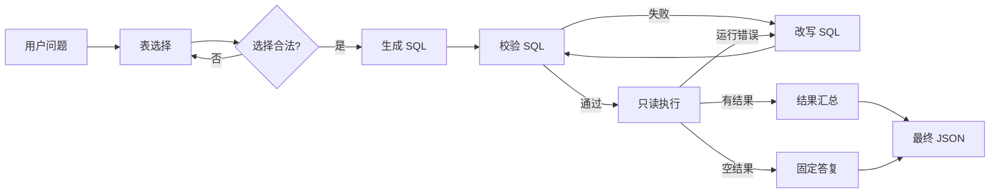

# Chinook SQL Agent

用自然语言查询 Chinook 音乐商店数据库的 SQL Agent。输入一个中文问题，系统自动完成
**表选择 → SQL 生成 → 安全校验 → 只读执行 → 自然语言汇总**，并同时提供命令行与 Web 界面。

- 编排：LangGraph `StateGraph`，分支、重试和预算全部由确定性代码控制
- LLM 步骤：LangChain LCEL 链 + `with_structured_output`，兼容 OpenAI 协议端点
- 安全：全程只读连接、单语句 / SELECT 白名单、`EXPLAIN` 预校验、行数与超时限制
- 前端：FastAPI 直接挂载 vendored layui 2.13.9 单页，无 CDN、可离线使用

## 工作流程



关键设计：

- 选表、生成、改写、汇总四个步骤调用 LLM；校验和执行是纯代码。
- 校验失败与执行失败共享最多 3 次修复预算，超限返回明确错误。
- 空结果不重试、不调用汇总模型，直接返回"未查询到符合条件的数据。"
- 最终 `WorkflowOutput` 由代码组装，模型无法伪造字段。

更完整的组件边界、数据契约和失败策略见 [docs/agent-design.md](docs/agent-design.md)。

## 目录结构

```text
.
├── run.py                      # 统一启动入口（Web / CLI）
├── pyproject.toml
├── src/sql_agent/
│   ├── config.py               # 环境变量配置
│   ├── models.py               # Pydantic 数据契约
│   ├── llm.py                  # ChatOpenAI 客户端与按请求覆盖
│   ├── graph.py                # LangGraph 节点、条件边、重试预算
│   ├── workflow.py             # 对外门面：编译图 → ainvoke → WorkflowOutput
│   ├── cli.py                  # 命令行入口
│   ├── api.py                  # FastAPI：/api/query、/api/config、静态页
│   ├── agents/                 # 四个 LLM Agent（提示词 + LCEL 链）
│   ├── db/                     # SchemaCatalog / SQLValidator / SQLExecutor
│   └── web/                    # layui 单页与静态资源
├── tests/                      # pytest（LLM 全部 mock，无需 API Key）
├── docs/agent-design.md        # 设计文档
└── ref/                        # 只读参考：chinook.db、参考 notebook / demo
```

## 快速开始

> 以下命令均在仓库根目录执行。

### 1. 环境要求

- Python 3.10+（开发环境使用 3.12）
- 一个兼容 OpenAI Chat Completions 协议的模型服务及 API Key

### 2. 安装依赖

使用 [uv](https://docs.astral.sh/uv/)（推荐，仓库已包含 `uv.lock`）：

```bash
uv sync --extra dev
```

或使用 pip：

```bash
python -m venv .venv
# Windows: .venv\Scripts\activate
source .venv/bin/activate
pip install -e ".[dev]"
```

### 3. 配置模型

```bash
# Linux / macOS
export OPENAI_API_KEY=sk-...
export OPENAI_BASE_URL=https://api.deepseek.com   # 可选，默认即此地址
export SQL_AGENT_MODEL=deepseek-flash             # 可选

# Windows PowerShell
$env:OPENAI_API_KEY="sk-..."
```

也可以在仓库根目录创建 `.env`（`run.py` 会自动加载，且不会覆盖已存在的环境变量）：

```dotenv
OPENAI_API_KEY=sk-...
OPENAI_BASE_URL=https://api.deepseek.com
SQL_AGENT_MODEL=deepseek-flash
SQL_AGENT_SUMMARY_MODEL=deepseek-flash
```

> API Key 只从环境变量或页面临时输入中读取；不会写入日志，也不会由 `/api/config` 返回。

### 4. 启动

```bash
python run.py                          # Web 界面：http://127.0.0.1:8000/
python run.py --reload --port 8080     # 开发模式：热重载 + 指定端口
python run.py --host 0.0.0.0           # 允许局域网访问
python run.py "总共有多少张专辑？"      # 命令行直接提问
python run.py --cli                    # 命令行模式，问题从 stdin 读取
```

未激活虚拟环境时，用解释器路径调用即可，例如 Windows：
`.venv\Scripts\python.exe run.py`。

传统方式同样可用：

```bash
PYTHONPATH=src python -m sql_agent "总共有多少张专辑？"
PYTHONPATH=src uvicorn sql_agent.api:app --reload
```

CLI 模式下：最终 JSON 输出到 **stdout**，日志输出到 **stderr**，便于管道处理。
若查询出错，退出码为 1。

### 5. 打开 Web 界面

浏览器访问 `http://127.0.0.1:8000/`：

- 输入问题或点击示例问题，查看自然语言答案、最终 SQL、结果表格与修复次数
- 右上角"接口设置"可按请求覆盖 `base_url`、API Key、主模型和汇总模型
- 每次覆盖通过 `ContextVar` 隔离，并发请求互不影响
- Swagger 文档：`http://127.0.0.1:8000/api/docs`

### 6. 测试与检查

```bash
pytest -q                 # 单元/工作流测试，LLM 已 mock，无需 API Key
ruff check src tests      # 代码风格
```

## Web API

| 方法 | 路径 | 说明 |
| --- | --- | --- |
| `GET` | `/` | layui 单页 |
| `GET` | `/api/health` | 健康检查 |
| `GET` | `/api/config` | 默认模型、示例问题、数据库表概览（不含 Key） |
| `POST` | `/api/query` | 自然语言查询 |

查询示例：

```bash
curl -s http://127.0.0.1:8000/api/query \
  -H "Content-Type: application/json" \
  -d '{"question": "每个流派的歌曲数量分别是多少？"}'
```

可选地在请求体中覆盖模型配置（字段为空则使用服务端默认值）：

```json
{
  "question": "销售额最高的 5 位客户是谁？",
  "llm": {
    "base_url": "https://api.deepseek.com",
    "api_key": "sk-...",
    "model": "deepseek-flash",
    "summary_model": "deepseek-flash"
  }
}
```

成功响应为 `WorkflowOutput`：

```json
{
  "question": "总共有多少张专辑？",
  "answer": "数据库中共有 347 张专辑。",
  "sql": "SELECT COUNT(*) AS n FROM albums",
  "tables": ["albums"],
  "columns": ["n"],
  "rows": [["347"]],
  "row_count": 1,
  "truncated": false,
  "repair_attempts": 0,
  "evidence": ["347"],
  "caveats": [],
  "error": null
}
```

## 配置项

| 环境变量 | 默认值 | 说明 |
| --- | --- | --- |
| `OPENAI_API_KEY` | 无 | 模型服务密钥，命令行模式必需 |
| `OPENAI_BASE_URL` | `https://api.deepseek.com` | OpenAI 兼容端点 |
| `SQL_AGENT_MODEL` | `deepseek-flash` | 选表 / 生成 / 改写所用模型 |
| `SQL_AGENT_SUMMARY_MODEL` | `deepseek-flash` | 结果汇总模型 |
| `SQL_AGENT_DB` | `ref/chinook.db` | 数据库路径，相对路径基于仓库根目录 |
| `SQL_AGENT_MAX_REPAIR_ATTEMPTS` | `3` | SQL 修复总预算 |
| `SQL_AGENT_MAX_ROWS` | `200` | 执行层返回行数上限 |
| `SQL_AGENT_MAX_SUMMARY_ROWS` | `50` | 进入汇总 prompt 的最大行数 |
| `SQL_AGENT_MAX_CELL_CHARS` | `2000` | 单个单元格字符上限 |
| `SQL_AGENT_QUERY_TIMEOUT` | `5.0` | 单条查询超时（秒） |
| `SQL_AGENT_LLM_TIMEOUT` | `60.0` | LLM 请求超时（秒） |
| `SQL_AGENT_LLM_MAX_RETRIES` | `2` | LLM 请求重试次数 |
| `SQL_AGENT_LOG_LEVEL` | `INFO` | `DEBUG` / `INFO` / `WARNING` / `ERROR` |
| `UVICORN_HOST` | `127.0.0.1` | `run.py` 默认监听地址 |
| `UVICORN_PORT` | `8000` | `run.py` 默认监听端口 |

## 安全设计

| 风险 | 措施 |
| --- | --- |
| 模型生成写操作 | 只读连接 `mode=ro` + 单语句 + `SELECT`/`WITH` 白名单 + 危险关键字拒绝 |
| 多语句注入 | 拒绝分号分隔的多语句，校验前去尾分号 |
| 访问内部表 | 目录只暴露 11 张业务表，过滤 `sqlite_%` |
| 慢查询 / 大结果 | 5 秒超时，执行层 200 行、单元格 2000 字符截断 |
| 无限修复 | 校验与执行失败共享 3 次预算，超限终止 |
| 提示注入 | 用户问题以数据形式放入 `<question>`，schema 仅来自目录 |
| 密钥泄露 | 只读环境变量或请求内临时值，日志脱敏，不回显 |

`SQLValidator` 只用 `EXPLAIN` 编译 SQL，绝不执行；执行阶段也只连接只读 URI。

## 数据库

内置 `ref/chinook.db` 是 Chinook 示例库，共 11 张业务表（`albums`、`artists`、
`customers`、`employees`、`genres`、`invoice_items`、`invoices`、`media_types`、
`playlist_track`、`playlists`、`tracks`），列名为 PascalCase，表名为小写。

可通过 `SQL_AGENT_DB` 指向其他 SQLite 文件（需具备相同结构的只读访问能力）。

## 已知边界

- 仅支持单库、单轮问答，不支持多轮追问或多方言切换
- 不执行任何写操作
- 结果为多行时，汇总模型最多看到前 50 行；完整结果已在响应中返回（受 200 行上限约束）
- `ref/` 为只读参考材料：`ref/sql-agent.ipynb` 中两个 Agent 仍是空实现，
  notebook 里的硬编码 API Key 与调试用 Q/A 生成逻辑不可直接用于生产

## 参考

- 设计文档：[docs/agent-design.md](docs/agent-design.md)
- 协作与实现约定：[AGENTS.md](AGENTS.md)
- 参考 notebook：`ref/sql-agent.ipynb`（`jupyter lab ref/sql-agent.ipynb`）
- 参考 demo：`ref/agent-demo.py`
