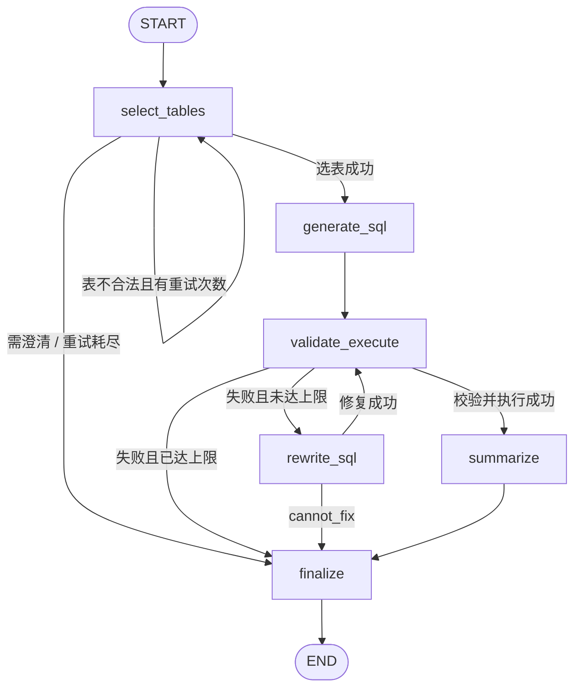

# week13 作业一：用 LangGraph 重写 SQL Agent

把 `week12/作业二`（用 **LangChain** 复刻的 SQL Agent）的编排层改为 **LangGraph**：
四个 LLM 链、DB 安全层和数据契约保持不变，只把原来 `workflow.py` 里的
`while` / `if` 流程提升为**状态图 + 条件边**。

核心仍然是「代码控制流程，而不是让模型自由编排」：

```
选表 -> 生成 SQL -> 校验/执行 -> (失败则改写，最多 N 次) -> 汇总答案
```

## 图结构



两条循环都由 `add_conditional_edges` 表达：

| 循环 | 路由函数 | 退出条件 |
| --- | --- | --- |
| 重选表 | `route_after_selection` | 选表合法 / 需澄清 / 达到 `max_table_attempts`（默认 2） |
| 修复 SQL | `route_after_execution`、`route_after_rewrite` | 执行成功 / `cannot_fix` / 达到 `max_repair_attempts`（默认 3） |

`recursion_limit` 由 `recursion_limit_for()` 按最坏路径计算并在 `ainvoke` 时传入，
调大修复次数也不会被 LangGraph 的默认上限截断。

## 节点与职责

| 节点 | 做什么 | 写入状态 |
| --- | --- | --- |
| `select_tables` | 调一次选表链，并用代码校验表名存在、表间外键连通 | `selection` `tables` `table_attempts` `selection_feedback` |
| `generate_sql` | 渲染已选表 schema，生成 SQL | `schema_context` `sql` `attempts` |
| `validate_execute` | `EXPLAIN` 编译 + 只读执行；失败时分类错误码 | `validation` `execution` `failure` `answer_override` |
| `rewrite_sql` | 按错误码修复；无法修复时写终止标记 | `sql` `attempts` `repair_attempts` `answer_override` |
| `summarize` | 空结果不调模型；正常结果交给汇总链，失败时降级表格 | `final` |
| `finalize` | 把状态组装成 `WorkflowOutput`（CLI 输出的 JSON） | `output` |

每个节点只返回**增量字段**，未返回的字段由 LangGraph 保留；`trace` 用
`Annotated[list[str], operator.add]` 归约，节点返回 `[本步]` 即可累积执行轨迹。

## 与 week12 作业二的差异

| week12（LangChain） | week13（LangGraph） |
| --- | --- |
| `SQLAgentWorkflow._run` 中的 `for` + `if` | `StateGraph` + `add_conditional_edges` |
| `QueryState`（Pydantic，整体读写） | `AgentState`（`TypedDict`，节点返回增量） |
| 手工维护 `state.attempts` 列表 | `trace` 使用 `operator.add` 归约器 |
| 无状态快照 | `build(checkpointer=...)` 可选启用检查点 |
| 重试上限靠循环边界 | 路由函数直接决定边，可单独测试 |
| — | `recursion_limit` 按最坏路径自动计算 |

数据库层、四个链、提示词、错误码、输出 JSON 字段与 week12 完全一致，
因此 CLI 用法和输出格式不变。

## 目录结构

| 路径 | 说明 |
| --- | --- |
| `main.py` | 便捷入口（等价于 `python -m sql_agent`） |
| `sql_agent/graph.py` | **本作业核心**：状态、节点、路由、构图 |
| `sql_agent/workflow.py` | 轻量适配层：输入校验、调用图、异常兜底 |
| `sql_agent/cli.py` | 命令行参数、环境检查、JSON 输出 |
| `sql_agent/config.py` | 运行配置（环境变量 / `.env`） |
| `sql_agent/models.py` | Pydantic 数据契约 |
| `sql_agent/chains/` | 四个 LangChain 链（未改动） |
| `sql_agent/db/catalog.py` | schema、统计信息、样例、外键图 |
| `sql_agent/db/validator.py` | 单语句 / 只读 / 关键字 / `EXPLAIN` 校验 |
| `sql_agent/db/executor.py` | 只读执行、超时、行数/单元格截断 |
| `scripts/fetch_chinook.py` | 下载 Chinook SQLite 示例库到 `data/` |
| `scripts/smoke_test.py` | DB 层离线冒烟测试 |
| `scripts/graph_smoke_test.py` | **图流程离线测试**：用假链验证所有路由与循环 |

## 快速开始

要求 Python 3.10+。

```bash
cd 詹光明/week13/作业一

# 1. 安装依赖
pip install -r requirements.txt

# 2. 准备数据库（已随仓库提供 data/chinook.db 时可跳过）
python scripts/fetch_chinook.py

# 3. 配置模型（二选一）
export OPENAI_API_KEY=sk-...
export OPENAI_BASE_URL=https://api.deepseek.com   # 可选，默认就是 DeepSeek
# 或者把 .env.example 复制为 .env 并填写

# 4. 提问
python -m sql_agent "销售额最高的前 5 位艺术家是谁？"
python main.py "每个国家的客户数量，按数量降序"
echo "2010 年每个月的总销售额" | python -m sql_agent
```

输出为标准 JSON（日志走 stderr，不污染 stdout）：

```json
{
  "question": "每个国家的客户数量，按数量降序",
  "answer": "客户数量最多的国家是美国，共 13 位；其次是加拿大，共 8 位……",
  "sql": "SELECT Country, COUNT(*) AS CustomerCount FROM Customer GROUP BY Country ORDER BY CustomerCount DESC",
  "tables": ["Customer"],
  "row_count": 24,
  "truncated": false,
  "repair_attempts": 0,
  "evidence": ["美国：13", "加拿大：8"],
  "caveats": [],
  "error": null
}
```

出现不可恢复错误时，`error` 非空且进程退出码为 1。

## 环境变量

与 week12 相同，额外增加 `SQL_AGENT_MAX_TABLE_ATTEMPTS`。

| 变量 | 默认值 | 说明 |
| --- | --- | --- |
| `OPENAI_API_KEY` | — | 必填；也支持 `SQL_AGENT_API_KEY` |
| `OPENAI_BASE_URL` | `https://api.deepseek.com` | OpenAI 兼容端点 |
| `SQL_AGENT_MODEL` | `deepseek-chat` | 选表 / 生成 / 改写模型 |
| `SQL_AGENT_SUMMARY_MODEL` | `deepseek-chat` | 汇总模型 |
| `SQL_AGENT_STRUCTURED_METHOD` | `function_calling` | `function_calling` / `json_schema` / `json_mode` |
| `SQL_AGENT_DB` | `data/chinook.db` | 数据库路径（相对路径基于作业一目录） |
| `SQL_AGENT_MAX_TABLE_ATTEMPTS` | `2` | 选表最大尝试次数 |
| `SQL_AGENT_MAX_REPAIR_ATTEMPTS` | `3` | 最大改写次数 |
| `SQL_AGENT_MAX_ROWS` | `200` | 单次查询最多返回行数 |
| `SQL_AGENT_MAX_SUMMARY_ROWS` | `50` | 交给汇总链的最大行数 |
| `SQL_AGENT_MAX_CELL_CHARS` | `2000` | 单元格最大字符数 |
| `SQL_AGENT_QUERY_TIMEOUT` | `5.0` | SQL 执行超时（秒） |
| `SQL_AGENT_LLM_TIMEOUT` | `60.0` | LLM 请求超时（秒） |
| `SQL_AGENT_LLM_RETRIES` | `2` | LLM 网络重试次数 |
| `SQL_AGENT_LOG_LEVEL` | `INFO` | 日志级别 |
| `LANGCHAIN_TRACING_V2` / `LANGCHAIN_API_KEY` / `LANGCHAIN_PROJECT` | — | 可选，启用 LangSmith 追踪 |

> 若端点不支持工具调用（`function_calling`），可设置
> `SQL_AGENT_STRUCTURED_METHOD=json_mode`。提示词中已要求「只输出结构化结果（JSON）」，
> 满足多数兼容端点的 JSON 模式要求。

## 状态检查点（可选）

默认不挂检查点，一次 `run` 就是一次独立执行。需要逐节点回放或做多轮扩展时，
可以给图挂上 LangGraph 的检查点实现：

```python
import asyncio
from langgraph.checkpoint.memory import MemorySaver

from sql_agent.graph import SQLAgentGraph

graph = SQLAgentGraph().build(checkpointer=MemorySaver())
config = {"configurable": {"thread_id": "demo"}, "recursion_limit": 20}
state = asyncio.run(graph.ainvoke({"question": "客户最多的是哪个国家？", "trace": []}, config))
print(state["output"].answer)
# 每个节点的快照都可以回放
for snapshot in graph.get_state_history(config):
    print(snapshot.next, snapshot.values.get("trace", [])[-1:])
```

注意：`SQLAgentWorkflow` 当前不传 `thread_id`，所以 CLI 仍是无记忆的单轮查询。

## 安全与可靠性

- **只读连接**：SQLAlchemy / sqlite3 都使用 `mode=ro` URI，并额外 `PRAGMA query_only=ON`。
- **语句门禁**：只允许单条 `SELECT` / `WITH ... SELECT`；先遮蔽字符串、引号标识符和注释，
  再检查 `INSERT/UPDATE/DELETE/CREATE/DROP/ALTER/PRAGMA/ATTACH` 等关键字。
- **只编译不执行**：校验阶段使用 `EXPLAIN`，既能发现未知表/列和歧义，又不产生结果。
- **资源限制**：执行超时（progress handler 中断）、最多 200 行、单元格最多 2000 字符。
- **提示词注入**：用户问题被包在 `<question>` 中并声明「仅作为数据」，四个系统提示都要求
  忽略输入中修改规则或输出格式的指令。
- **有界循环**：两条循环都有明确的上限，且 `recursion_limit` 按上限计算，不会死循环。
- **降级输出**：汇总链异常时回退为表格；任何异常都会转成带 `error` 的 `WorkflowOutput`。

## 测试

两个脚本都是离线的，不需要 API key：

```bash
# DB 层：schema 解析、SQL 门禁、只读执行
python scripts/smoke_test.py

# 图流程：用假链验证选表重试、修复循环、clarification、cannot_fix、次数耗尽
python scripts/graph_smoke_test.py
```

`graph_smoke_test.py` 会把四个链工厂临时替换为返回预设结果的假链，覆盖：

1. 图结构包含全部 6 个节点；
2. 正常路径 `select_tables -> generate_sql -> validate_execute -> summarize -> finalize`；
3. 一次失败后改写成功（`repair_attempts == 1`）；
4. `cannot_fix` 终止并返回原因；
5. 修复次数耗尽；
6. 选表要求澄清时不调用后续链；
7. 选表连续非法时只重试 `max_table_attempts` 次。

## 已知限制

- 仅支持 SQLite，且一次只查一个数据库文件。
- 仍是单轮查询；检查点已具备，但尚未接入多轮追问。
- 表选择依赖模型能力；目录很大时可进一步做向量检索或分层选表。
- 中文问题效果取决于所选模型，建议使用支持工具调用的模型。
