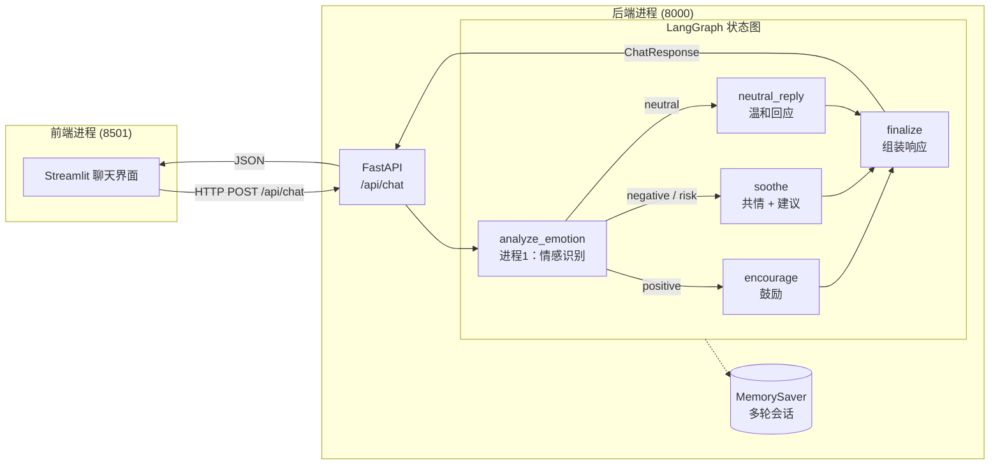
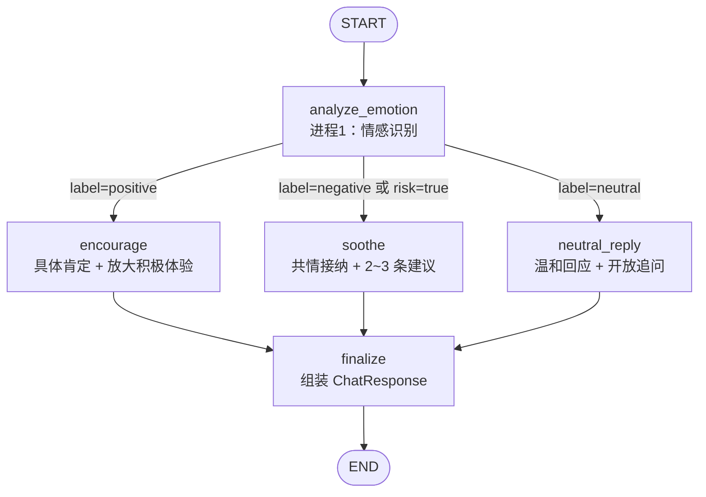

# 基于 LangGraph 的情绪陪伴助手

一个「先识别情绪，再决定怎么回应」的对话 Demo：

- **进程1**：情感识别 —— 判断用户这句话是正向、负面还是中性，并给出细分情绪、强度、置信度和判断依据；
- **进程2**：回应生成 —— 正向则鼓励，负面则先共情再给可执行建议（排解），中性则温和追问；
- **后端进程**：FastAPI 接收前端输入，用 **LangGraph 状态图** 串联进程1和进程2，并维护多轮会话；
- **前端进程**：Streamlit 聊天界面，展示回复与情绪识别详情。

## 一、整体架构



后端内部的状态图：



## 二、需求对照

| 作业要求 | 实现位置 |
| --- | --- |
| 进程1：接受请求进行情感识别 | `backend/graph.py` 的 `analyze_emotion` 节点，结构化输出 `EmotionResult` |
| 进程2：正向鼓励、负面排解 | `encourage` / `soothe` / `neutral_reply` 三个节点，由条件边路由 |
| 后端进程：接受前端输入，串联进程1和进程2 | `backend/main.py`（FastAPI）+ `backend/service.py`（调用状态图） |
| 前端进程：用户输入 | `frontend/app.py`（Streamlit） |
| 基于 LangGraph | `StateGraph` + `add_conditional_edges` + `MemorySaver`，节点只返回增量状态 |

> 按确认后的方案：**前端、后端是两个独立操作系统进程**；
> **进程1、进程2 是后端 LangGraph 状态图中的阶段节点**，由条件边连接。

## 三、功能特性

- **结构化情感识别**：`label` / `emotion` / `confidence` / `intensity` / `reason` / `keywords` / `risk`，前端可展开查看判断依据；
- **三条回复分支**：正向鼓励、负面共情 + 建议、中性追问，分支由代码决定，不交给模型自由编排；
- **多轮记忆**：`thread_id` + LangGraph `MemorySaver`，同一会话可接着聊；「新对话」会清空后端会话；
- **两级兜底**：结构化输出失败重试 1 次；仍失败则降级为固定文案，请求不会 500；
- **危机兜底**：模型识别 `risk` 或命中关键词时，切换到关怀模式，提示联系信任的人、120/110、心理援助热线 12356；
- **提示词注入防护**：用户输入统一放在 `<current_message>` 标签中，并声明只作为数据；
- **可观察**：响应里带本轮节点执行轨迹 `trace`，前端直接展示。

## 四、目录结构

```
work1-langgraph/
├── backend/
│   ├── __init__.py
│   ├── main.py          # FastAPI 入口（后端进程）
│   ├── config.py        # 环境变量 / .env 配置
│   ├── models.py        # Pydantic 数据契约
│   ├── prompts.py       # 进程1 / 进程2 提示词
│   ├── llm.py           # ChatOpenAI 构建与缓存
│   ├── text_utils.py    # 消息文本处理
│   ├── graph.py         # LangGraph 状态图（进程1 + 进程2）
│   └── service.py       # 图编译、MemorySaver、历史与删除
├── frontend/
│   └── app.py           # Streamlit 前端进程
├── scripts/
│   └── smoke_test.py    # 命令行冒烟测试
├── requirements.txt
├── .env.example
├── .gitignore
└── README.md
```

## 五、快速开始

以下命令都在 `work1-langgraph` 目录下执行。

### 1. 安装依赖

```bash
python -m venv .venv

# Windows PowerShell / CMD
.venv\Scripts\activate
# Git Bash
source .venv/Scripts/activate

pip install -r requirements.txt
```

### 2. 配置模型

```bash
# Windows CMD
copy .env .env
# Git Bash / PowerShell
cp .env .env
```

编辑 `.env`，至少填写：

```ini
OPENAI_API_KEY=sk-你的key
OPENAI_BASE_URL=https://api.deepseek.com
OPENAI_MODEL=deepseek-chat
```

> 切换到 DashScope / Qwen 只需改 `OPENAI_BASE_URL` 和 `OPENAI_MODEL`，代码不用动。

### 3. 启动后端进程

```bash
uvicorn backend.main:app --host 127.0.0.1 --port 8000
```

或者：

```bash
python -m backend.main
```

打开 <http://127.0.0.1:8000/docs> 可以看到接口文档，`/health` 会返回模型与 key 配置状态。

### 4. 启动前端进程

另开一个终端（同样进入 `work1-langgraph`，激活虚拟环境）：

```bash
streamlit run frontend/app.py
```

浏览器打开 <http://127.0.0.1:8501>，在输入框里说一句话即可。

### 5. 命令行冒烟测试（可选）

```bash
# 经过 HTTP（需要后端已启动）
python scripts/smoke_test.py

# 不启动后端，直接在本进程跑 LangGraph
python scripts/smoke_test.py --direct

# 自定义多轮
python scripts/smoke_test.py --direct -m "今天被批评了，好难受" -m "我有点不想说话"
```

默认会跑三条单轮场景（正向 / 负面 / 中性）和一组两轮多轮场景。

## 六、接口说明

### `POST /api/chat`

请求：

```json
{
  "message": "今天好累，感觉什么都做不好",
  "thread_id": "可选；不传则后端生成"
}
```

响应：

```json
{
  "thread_id": "8f3c...",
  "message": "今天好累，感觉什么都做不好",
  "emotion": {
    "label": "negative",
    "emotion": "tiredness",
    "confidence": 0.91,
    "intensity": 4,
    "reason": "用户表达了疲惫和自我否定",
    "keywords": ["好累", "做不好"],
    "risk": false
  },
  "reply": {
    "strategy": "soothe",
    "reply_text": "听起来你今天真的撑得很辛苦……",
    "suggestions": [
      "先离开屏幕，喝点水、做几次深呼吸",
      "把此刻最压在心上的事写下来，只写一件",
      "找一个信任的人说说现在的感受"
    ]
  },
  "trace": ["analyze_emotion(label=negative, emotion=tiredness, risk=False, degraded=False)", "soothe(suggestions=3, degraded=False)", "finalize"]
}
```

`strategy` 取值：`encourage` / `soothe` / `neutral_reply`。

### 其他接口

| 方法 | 路径 | 说明 |
| --- | --- | --- |
| `GET` | `/health` | 健康检查、模型名、key 是否配置 |
| `GET` | `/api/history?thread_id=...` | 读取某会话的消息历史 |
| `DELETE` | `/api/thread/{thread_id}` | 删除某会话（前端「新对话」会调用） |

## 七、关键设计

### 1. 为什么把进程1 / 进程2 放在图里？

- 节点职责单一：`analyze_emotion` 只识别，三个回复节点只生成；
- 路由是纯函数：`route_after_emotion` 按 `label` / `risk` 返回目标节点，方便单测和演示；
- 多轮状态由 `MemorySaver` 管理，节点只读写自己需要的字段。

### 2. 情感识别为什么用结构化输出？

`with_structured_output(EmotionResult)` 把模型输出约束成 Pydantic 模型，
避免解析自然语言 JSON 的不稳定；失败重试一次，再失败走兜底，
保证后端接口始终有稳定响应。

### 3. 负面情绪的「排解」怎么做？

`SOOTHE_SYSTEM_PROMPT` 固定了三步：**共情接纳 → 2~3 条低门槛建议 → 温柔收尾**，
并明确禁止诊断、说教、强行正能量。代码再保证建议至少有 2 条。

### 4. 危机情况怎么处理？

两道路径：

1. 模型在 `EmotionResult.risk` 中标记；
2. 关键词规则兜底（`CRISIS_KEYWORDS`，可在 `.env` 覆盖）。

任一命中都会路由到 `soothe`，并改用 `CRISIS_REPLY_SYSTEM_PROMPT`，
引导用户联系信任的人、拨打 120 / 110 或全国心理援助热线 12356。
这不是医疗建议，只是安全兜底。

## 八、常见问题

**Q：前端提示「无法连接后端」？**
先确认后端已启动、端口一致；浏览器打开 <http://127.0.0.1:8000/health> 应返回 JSON。

**Q：`/health` 显示 `api_key_configured: false`？**
`.env` 没填 key，或填的还是 `sk-xxxxxx` 占位符。填好后重启后端。

**Q：回复总是兜底文案？**
看后端日志里的 `stage=emotion_failed` / `stage=reply_failed`，
通常是 key 无效、base_url 不对、模型不支持 function calling，或网络超时。

**Q：重启后端后历史没了？**
当前使用 `MemorySaver`（内存），按需求确认单不落数据库。需要持久化可替换为
`SqliteSaver` 等 checkpointer。

**Q：能换成其他模型吗？**
只要兼容 OpenAI Chat Completions 协议即可，改 `.env` 里的三项配置。

## 九、验收清单

- [x] 后端 `/health` 可用，`/api/chat` 返回结构化情感结果与回复
- [x] 正向 → `encourage`，负面 → `soothe`（共情 + 建议），中性 → `neutral_reply`
- [x] 同一 `thread_id` 下多轮对话可接上下文
- [x] 前端展示回复、情绪标签、置信度、判断依据和执行轨迹
- [x] key 只从 `.env` 读取，代码中无硬编码
- [x] `scripts/smoke_test.py` 可脱离前端验证整条链路
- [x] 模型失败时降级，不返回 500
