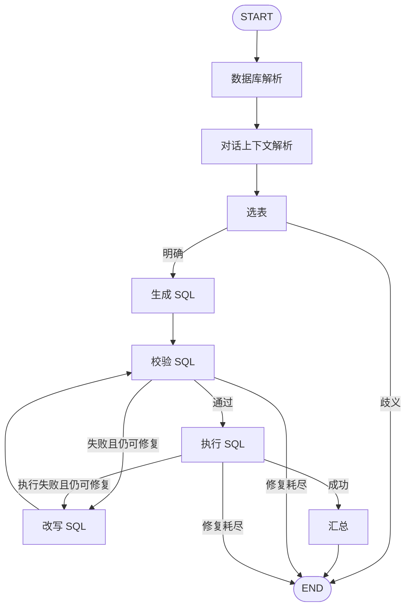

# 第十三周作业：LangGraph SQL Agent + 网页对话

## 交付文件

- `graph_agent.py`：作业一，真正使用 StateGraph、START/END、条件边编排。
- `app.py`、`static/index.html`：作业二，FastAPI 后端和响应式对话前端。
- `chains.py`：LangChain 提示模板、Pydantic 结构化解析及数据类型。
- `sql_core.py`、`chinook.db`：沿用前期作业的只读 SQLite 工具及教学数据库。
- `test_graph.py`：8 项自动化测试。
- `outputs/example.json`：带错误修复的真实数据库查询轨迹。
- `outputs/workflow.mmd`：从编译后的 LangGraph 自动导出的 Mermaid 图。

## 安装与启动

在此目录运行，建议 Python 3.10+ 和独立虚拟环境：

```powershell
python -m pip install -r requirements.txt
python -m uvicorn app:app --host 127.0.0.1 --port 8013
```

浏览器打开 http://localhost:8013 。默认离线演示，不需要密钥。点左侧示例填入问题，再发送。网页展示 SQL、数据表、执行路径和 CSV 下载，失败时提示错误，新建对话清空上下文。

离线模式仅支持五个示例问题，以及国家排行后的“改为前三名”。使用固定 SQL 测试替身，但选表后的查询、校验、执行和图路由真实运行；不是大模型泛化能力演示。

### 自由问答

在启动服务器的同一个 PowerShell 中设置以下环境变量，再启动或重启服务器，网页切换“真实模型”：

```powershell
$env:SQL_API_KEY = '你的密钥'
$env:SQL_BASE_URL = 'https://dashscope.aliyuncs.com/compatible-mode/v1'
$env:SQL_MODEL = 'qwen-plus'
python -m uvicorn app:app --host 127.0.0.1 --port 8013
```

地址及模型名按实际账号权限配置。未配置时返回 503，不会静默伪装为真实模型。课程文件含硬编码密钥，本次实现不沿用。`.env.example` 为参考，程序不自动加载它。

命令行演示：

```powershell
python graph_agent.py --inject-error
python graph_agent.py --mode live --question '各国家销售额排名前五的是哪些？'
python -m unittest -v test_graph
```

## 作业一：图设计



State 是 TypedDict，保存原问题、独立问题、选表、SQL、错误、结果、修复次数；trace 使用 Annotated[list, operator.add] 累积每个节点事件。七阶段都是独立节点，额外的 context 节点负责追问理解。最多改写两轮，图递归上限 40。阶段异常转为 failed，无法选表时返回 clarification；汇总调用失败仍保留实际查询结果。

与上一周的差异：上一周用 Python for 循环控制修复，本周用 sql_validate/sql_execute 的条件边回到 sql_rewrite；主程序执行的是 graph.invoke，而不是将旧 run 包装成单一节点。

参考 Week13 `02_langgraph教程/01_graph_api基础.py` 的 StateGraph、条件路由和 reducer；阅读 `03_持久化.py` 了解 checkpoint 用法。本作业未启用 checkpointer，避免把普通聊天上下文误称为检查点恢复。

## 作业二：前后端与会话

浏览器 POST `/api/chat`，字段为 question、mode、history。服务端校验长度、历史条数和角色，只允许 user/assistant。真实模型把最近对话转换成独立问题，再进入 SQL 流程。前端保留最多 5 轮对话；刷新、切换模式或新建对话均清空。服务端每次请求独立建图，无全局共享会话，不混用其他用户的历史。

GET `/api/config` 返回可用模式和五个示例。前端仅通过 textContent 展示数据库和模型文字，避免解释其中的 HTML；CSV 对公式样式文本做前缀处理。导出范围与显示结果一致，最多 200 行，截断时明确标记。

该版本是本地教学应用，没有登录、持久化聊天或公网部署；真实模型会收到当前问题、有限历史、schema 及查询结果。更换为内部数据库前应增加身份鉴别、列权限与日志脱敏。

## 数据库约束

数据库 URI 使用 mode=ro，开启 query_only；入口只允许 SELECT/WITH，SQLite authorizer 进一步限制表和函数。通过 EXPLAIN QUERY PLAN 校验；执行有 3 秒进度检查和 200 行返回限制。语法有效并不能保证指标口径正确；应核对 SQL 与返回表格。金额保持数据库单位，不推断货币。

## 实际验证（2026-11-06）

8 项自动化测试通过：五例结果、图修复分支、修复上限、澄清、上下文追问、只读防护、真实模型链结构的 FakeListChatModel 测试以及 HTTP API 验证。浏览器中已点击国家排行示例并发送，看到 USA / 523.06 等五行数据、执行 SQL 和查询完成状态。

已追加 DeepSeek 真实联机验证，见下节；FakeListChatModel 和 demo 仍明确属于离线测试。尚未做手机浏览器实机和生产并发测试。接口请求是完整响应模式，不提供 token 流式输出。

### DeepSeek 真实验证

使用官方 `https://api.deepseek.com` 的 `deepseek-flash`，7 项全部通过：国家排行、曲风多表销售、2013 月度汇总、客户数、2099 空结果、上下文改为前三名、注入 TotalAmount 错误后真实模型改写（1 次修复）。五个基础问题和追问经 FastAPI TestClient 调用实际后端，不使用模拟模型；故障注入仅替换生成节点的 SQL，其余节点调用真实模型。

`outputs/deepseek_validation.json` 保存最终响应、SQL、结果、图轨迹与验证状态；`deepseek_validation_initial.json` 保留首轮发现问题的记录。修正了国家排行业务口径，避免模型无必要地追问；验证器允许同一固定列投影及额外描述字段，保持全部行的顺序和值比较，并容忍浮点尾差（绝对 1e-6、相对 1e-9）。这七项验证不是大规模准确率评测，也不自动证明所有自然语言汇总结论正确。

密钥从之前作业的本地配置读取，仅放入进程环境，不复制到本目录。复现：

```powershell
python verify_deepseek.py --credentials "C:\Users\haozh\Desktop\cours\AI_cours\week07\pageindex_homework\API配置.env"
python serve_deepseek.py --credentials "C:\Users\haozh\Desktop\cours\AI_cours\week07\pageindex_homework\API配置.env"
```

第二条命令启动已配置 DeepSeek 的本地服务。网页选择“真实模型 · 自由问答”。实际 localhost HTTP 冒烟查询记录另存于 `outputs/deepseek_http_smoke.json`。

官方参考：[StateGraph](https://reference.langchain.com/python/langgraph/graph/state/StateGraph)、[条件边](https://reference.langchain.com/python/langgraph/graph/state/StateGraph/add_conditional_edges)。
