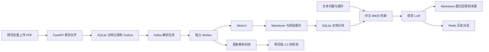

# 第十四周作业

## 作业 1

优云智算注册已由本人完成，控制台读取到的 Company ID 为 **69169043**。提交证据见 `company-id.png`。请将这个编号发送给老师，以便共享课程镜像。

`redis_demo.py` 使用 Redis List 保存多轮对话，通过事务写入完整的一问一答，保留最近 40 条消息，保存 7 天。同一 session 可以在不同进程读取。

`kafka_demo.py` 支持生产和消费消息，生产者等待 broker 确认，消费者处理消息后手动提交 offset。

在镜像的终端中进入本作业目录并安装依赖。推荐使用 Python 3.10–3.12，与课程 MinerU 环境保持兼容。

```bash
python -m pip install -r requirements.txt
cp .env.example .env
```

已有 Redis 和 Kafka 服务时，在 `.env` 中配置对应地址。需要自行启动中间件且环境具备 Docker Compose 时，可以执行下面的命令。

```bash
docker compose up -d
```

Redis 示例写入一轮对话，再启动一个独立进程读取。

```bash
python redis_demo.py --question "Redis 在这个项目中做什么？" --answer "保存最近的历史对话。"
python redis_demo.py
```

Kafka 示例先在终端 A 启动消费者，然后在终端 B 发送消息。首次启动主题可能需要几秒钟。

```bash
# 终端 A，持续接收，Ctrl+C 退出
python kafka_demo.py consume

# 终端 B
python kafka_demo.py produce --message "第一条 Kafka 消息"
python kafka_demo.py produce --message "开始解析 PDF"
```

## 作业 2

### 自建优云智算镜像

可从平台基础镜像创建实例，安装作业环境并联调，再将实例保存成自己的私有镜像。已在控制台找到 `python310_torch260_cu124`，对应 Ubuntu 22.04、CUDA 12.4、PyTorch 2.6.0、Python 3.10。

平台提示基础镜像创建的容器实例不支持再次安装 Docker。该场景可使用新增的原生部署脚本，安装 Java 17、Redis、Kafka 4.0.1、MinerU 和 Python 依赖，并生成 Supervisor 服务配置。脚本尚未在云端实例执行验证。

```bash
# 将作业目录上传到新实例，进入目录后执行
bash deploy_image.sh

# 填写 .env 中的视觉模型配置，再运行服务
.venv/bin/python -m supervisor.supervisord -n -c .runtime/supervisord.conf

# 另一终端查看服务状态
.venv/bin/python -m supervisor.supervisorctl -c .runtime/supervisord.conf status
```

完成真实 PDF、Kafka 消费、Redis 历史和视觉问答验收后，可在实例保持开机时制作私有镜像。模型服务通过个人环境中的 `.env` 配置，提交代码包使用 `.env.example`。

镜像存储按实际容量持续计费，当前官方文档列出 0.008 元/GB/日。实际实例价格、库存、镜像容量与费用以创建时控制台为准。[镜像制作说明](https://compshare.cn/docs/operation/image/imagecommunity) [计费说明](https://compshare.cn/docs/operation/charge/bill)

### 实现流程



- 批量选择 1–20 个 PDF，每份最大 50 MB。前端通过 HTTP 将 PDF 交给 API，API 保存文件，Kafka 传递文档 ID 和任务 ID。API 与 Worker 使用同一数据目录，符合课程示例的文件引用方案。
- 文档状态依次显示“待解析”“解析中”“解析完成”。解析失败展示错误，并提供重新解析按钮。完成后可查看 Markdown、表格与图片。
- Worker 调用真实的 MinerU CLI，保存 Markdown 和提取图片，按照段落分块。检索采用支持中文单字、双字和英文单词的 BM25，适合课程小型知识库。
- 文本提问结合相关分块回答。附图提问先将问题和图片一起发送给视觉模型提取关键词，再检索资料，将原问题、原图和相关资料图片一起送入视觉模型生成最终回答。
- 回答支持 Markdown 图片、表格、代码块和来源编号。前端使用本地打包的 Marked 与 DOMPurify 渲染，图片链接限定为已解析的本地资料图片。
- Redis 保存最近 20 轮文本对话，刷新网页可恢复。原始用户附图仅用于当前提问，历史中保存该轮文本和答案。用户需要再次讨论原图时可重新附图。

### 启动 MinerU

课程镜像已有 MinerU 时，可先执行 `mineru --help` 确认版本。项目默认使用课件中的 2.x/3.x 命令格式。

```bash
# 缺少 MinerU 时，在兼容的课程 Python 环境安装
python -m pip install -r requirements-mineru.txt

# 独立验证课件命令，首次运行需要下载模型
mineru -p /path/to/example.pdf -o ./data/mineru-check -b pipeline
```

默认 `MINERU_BACKEND=pipeline`，可在 CPU 环境运行。课程镜像若已启动 `mineru-openai-server`，可配置下面两项。

```dotenv
MINERU_BACKEND=vlm-http-client
MINERU_SERVER_URL=http://127.0.0.1:30000
```

如果使用 MinerU 4.x，将 `MINERU_CLI_STYLE=modern`，Worker 会调用 `mineru parse <pdf> -o <output> --pages all`。该分支按照当前官方文档实现，尚未在本机安装验证。课程镜像优先使用默认 legacy 分支。

### 配置视觉模型并启动应用

编辑 `.env`，填写自己可用的 OpenAI-compatible 视觉服务地址、密钥和模型名。默认示例为通义千问视觉服务，实际可用模型以账号为准。

```dotenv
LLM_BASE_URL=https://dashscope.aliyuncs.com/compatible-mode/v1
LLM_API_KEY=填写自己的密钥
LLM_MODEL=qwen-vl-plus
```

在同一个作业目录下打开两个终端。

```bash
# 终端 A
python -m uvicorn app.main:app --host 127.0.0.1 --port 8014

# 终端 B
python -m app.worker
```

本机访问 `http://127.0.0.1:8014`，API 文档位于 `/docs`。Windows 复制环境文件可使用 `Copy-Item .env.example .env`。本次已建立 `.venv`，Windows 启动时可将 `python` 替换为 `.venv/Scripts/python`。

云端课程镜像可使用平台提供的应用端口访问方式。另一种方式是通过已有 SSH 连接将本地端口转发到镜像内的 8014 端口，SSH 主机和端口以控制台信息为准。

```bash
ssh -L 8014:127.0.0.1:8014 -p <SSH端口> root@<SSH主机>
```

### 消息与故障处理

文档记录和待发事件在 SQLite 同一事务写入。Kafka 暂时不可用时保留待解析状态，API 后台每 3 秒继续投递。收到 Kafka 确认后才标记事件已投递，确认丢失可能导致消息重放。

Worker 持久化成功结果或失败状态后才提交 offset。数据库提交失败会重新连接并读取未提交消息。已完成任务和已被重试替换的旧任务会跳过，分块以事务替换，避免消息重放造成重复索引。解析失败后通过网页发起重试，会生成新的任务 ID。

原始 PDF 位于 `data/uploads`，每次解析的 Markdown、图片及 MinerU 日志位于 `data/processed`，元数据和文本索引位于 `data/rag.sqlite3`。API 和 Worker 必须共享该目录。当前实现面向单用户课程演示，应用默认监听本机地址。

### 验收步骤

1. 运行 Redis 示例，关闭后重新读取，确认历史仍存在。
2. 启动 Kafka 消费者，发送两条消息，记录消费输出。
3. 同时上传两份含图片的 PDF，观察待解析、解析中、解析完成。
4. 点击查看结果，检查 Markdown 和图片保留情况。
5. 提问“结合文档解释其中的图表”，检查回答和来源，确认相关图片可显示。
6. 附加一张图片并输入问题，检查视觉模型输出。
7. 刷新页面，检查 Redis 恢复历史。

### 本次验证范围

```bash
python check_homework.py
```

6 项回归检查已通过，覆盖批量上传和内容验证、Outbox 入库、Worker 完成及重复消费、失败重试及旧事件隔离、资料图片路径与多模态请求、聊天历史事务写入，以及 MinerU 命令构造。Kafka、Redis、MinerU 和视觉 LLM 的外部边界使用显式模拟。

已完成 Python 编译、JavaScript 语法检查及真实浏览器页面检查。浏览器控制台未发现脚本错误，布局截图见 `web-preview.png`。

已复用第十周作业的有效 DeepSeek 配置，将本地 `.env` 配置为 `deepseek-flash`。真实视觉请求识别测试图中的数字 37，随后通过应用的 `rag.answer` 正常入口识别另一张图中的数字 42，两次均正确。密钥保存在本地忽略的 `.env` 中。

已在优云智算实例 `uhost-1xm6kl6y2oam` 完成 7 项真实联调，详细结果见 `integration-report.json`。两份各 3 页的课程 PDF 均经过真实 Kafka 任务消费和 MinerU 2.7.6 解析，状态完整经过 queued、parsing、completed。图像保留、文本问题图文混排、图片与问题一起传入真实视觉模型，以及 Redis 多轮历史恢复均已通过。网页截图见 `parse-progress.png` 与 `live-rag.png`。云端 6 项回归检查和依赖一致性检查也已通过。

当前运行配置采用 MinerU pipeline/CPU、中文 BM25 和 DeepSeek Flash 视觉 API。模型配置保存在个人环境的 `.env` 中，代码提交包使用 `.env.example`。已授权的部署 AccessKey 保存在本地 `.runtime/compshare.env`。

自建私有镜像名称为 `week14-rag-hzk-verified`，项目位于镜像内 `/root/week14_homework`。启动该镜像的实例后，在终端执行下面的命令，再通过 SSH 将本地 8014 端口转发到实例的 8014 端口。

```bash
cd /root/week14_homework
.venv/bin/python -m supervisor.supervisord -c .runtime/supervisord.conf
.venv/bin/python -m supervisor.supervisorctl -c .runtime/supervisord.conf status
```

实例计算预算上限为本次累计 10 元，完成镜像保存后关机。私有镜像保留模型 API 运行配置，镜像存储按平台日费率继续计费。镜像已保存为 Available，ID 为 `compshareImage-1xmgwl4qldzx`。源实例已确认 Stopped，累计运行 11732 秒，按 2.05 元/小时估算计算费用约 6.68 元。详细交付记录见 `deployment-result.json`。

### 参考资料

课程依据为 `week14.md`、`Week14/02_MinerU.md` 和 `05-multimodal-rag-chatbot.zip`，项目沿用课程的文件任务队列流程，并补充任务状态及图片输入。

MinerU 的当前 CLI 和课程版本存在差异，版本兼容说明参考官方文档。[MinerU 使用指南](https://opendatalab.github.io/MinerU/usage/quick_usage/)

Kafka 的生产、消费和主题概念参考官方指南。[Apache Kafka Quickstart](https://kafka.apache.org/quickstart/)

Company ID 的查看方法参考平台 FAQ。[优云智算 FAQ](https://www.compshare.cn/docs/operation/gpufaq)
