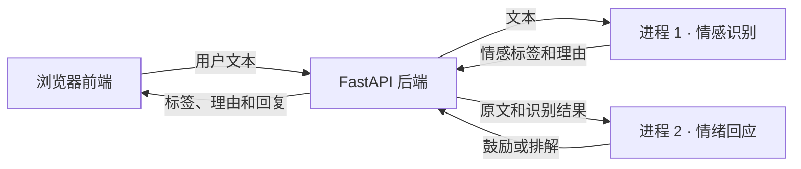

# 第十五周作业 · 情感识别与回应

## 提交文件

- 作业 1 提交 `sentiment/` 下的 6 个源码文件、`requirements-agents.txt`、`requirements-langgraph.txt`、`.env.example` 和本说明。
- 作业 2 提交 `Dockerfile`、`.dockerignore` 和 [未压缩的 Docker 镜像](week15-sentiment-agents-1.0-linux-amd64.tar)。重新构建镜像时会用到作业 1 的源码和 OpenAI Agents 依赖文件。

提交源码时保留 `sentiment/` 目录。真实模型配置和密钥保留在本地。

## 作业 1 · 两种实现

浏览器接收文本，通过 `POST /api/analyze` 交给 FastAPI。后端先调用情感识别进程，验证其返回的 `polarity` 和 `reason`，再把原文和识别结果交给回复进程。两个工作进程由后端用 `spawn` 分别启动。正向走鼓励分支，负面走共情和排解分支。按题目的二分类要求，中性文本归到正向分支，由回复进程温和回应。



| 版本 | 工作流 |
| --- | --- |
| [LangGraph](sentiment/langgraph_workflow.py) | `StateGraph` 的识别节点更新状态，再由条件边选择 `encourage` 或 `comfort`。工作进程通过 `ChatOpenAI` 请求模型。 |
| [OpenAI Agents](sentiment/agents_workflow.py) | 后端依次运行识别 Agent 和回应 Agent。两个工作进程分别调用 `Runner.run`，回应 Agent 根据已验证的情感标签选择提示词。 |

### 在 Windows 启动

在本目录打开 PowerShell，使用 Python 3.13。

```powershell
py -3.13 -m venv .venv
& .\.venv\Scripts\python.exe -m pip install -r requirements-agents.txt -r requirements-langgraph.txt
```

在两个启动终端中先执行下面的配置命令。应用直接读取第十四周作业已有的 `LLM_API_KEY`、`LLM_BASE_URL` 和 `LLM_MODEL`。

```powershell
$env:SENTIMENT_ENV_FILE = (Resolve-Path -LiteralPath '../../week14/第十四周作业/.env').Path
```

单独使用本作业时，可以将 `.env.example` 复制为 `.env`，填写自己的 `OPENAI_API_KEY`。默认模型为 `gpt-4.1-mini`。使用 DeepSeek 时，可设置 `OPENAI_MODEL=deepseek-flash` 和 `OPENAI_BASE_URL=https://api.deepseek.com`。

分别在两个终端中启动服务。

```powershell
# OpenAI Agents
& .\.venv\Scripts\python.exe -m uvicorn sentiment.server:create_agents_app --factory --port 8015
# LangGraph
& .\.venv\Scripts\python.exe -m uvicorn sentiment.server:create_langgraph_app --factory --port 8016
```

分别打开 [OpenAI Agents](http://127.0.0.1:8015) 和 [LangGraph](http://127.0.0.1:8016)。可用页面上的两个示例，也可输入自己的文本。

| 输入 | 预期情感 | 预期回应 |
| --- | --- | --- |
| 我坚持练习了一个月，今天终于跑完了五公里，特别开心！ | `positive` | 肯定练习和进步，给予鼓励。 |
| 我为面试准备了很久，今天还是没通过，感觉很沮丧。 | `negative` | 承认失望，给出一个可行的小建议。 |
| 纯空白或超过 1000 字符 | HTTP 422 | 页面提示输入范围。 |

## 作业 2 · 打包 OpenAI Agents

[Dockerfile](Dockerfile) 使用 Python slim 基础镜像，安装 OpenAI Agents 版的依赖，启动前端页面与 FastAPI 服务。

可在 Linux 容器模式下导入发布的镜像，或从 Dockerfile 构建同名镜像。[未压缩的 Linux amd64 镜像](week15-sentiment-agents-1.0-linux-amd64.tar)

```powershell
# 导入已打包的镜像
docker load -i week15-sentiment-agents-1.0-linux-amd64.tar
# 从源码构建
docker build -t week15-sentiment-agents:1.0 .
```

运行时只读挂载使用的模型配置文件。已有本作业的 `.env` 时，也可以将 `$modelConfig` 指向它。

```powershell
$modelConfig = (Resolve-Path -LiteralPath '../../week14/第十四周作业/.env').Path
docker run --rm --init -p 127.0.0.1:8000:8000 `
  --env SENTIMENT_ENV_FILE=/run/secrets/model.env `
  --mount "type=bind,source=$modelConfig,target=/run/secrets/model.env,readonly" `
  week15-sentiment-agents:1.0
```

运行后可打开网页或检查健康状态。[容器前端](http://127.0.0.1:8000) · [健康接口](http://127.0.0.1:8000/health)

自行导出时可运行 `docker save -o week15-sentiment-agents-1.0-linux-amd64.tar week15-sentiment-agents:1.0`。

## 验证记录

2026 年 11 月 20 日复用第十四周配置，连接 DeepSeek 的 `deepseek-flash` 模型。两个版本都通过了浏览器端的正向鼓励和负面排解测试，并正确拒绝纯空白与超长输入。

在 WSL 2 中重新构建了 `week15-sentiment-agents:1.0`。容器通过只读挂载连接同一真实模型，正向与负面请求均成功，健康状态为 `healthy`，空白请求返回 HTTP 422。重新导出的镜像已通过 `docker load` 验证。

课程资料可对应阅读《Agent 运行时设计》第 8–19 页、《多 Agent 通信与协同》第 4、9 页和《AI 应用生产化全景》第 17–19 页。
